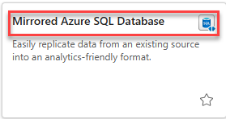
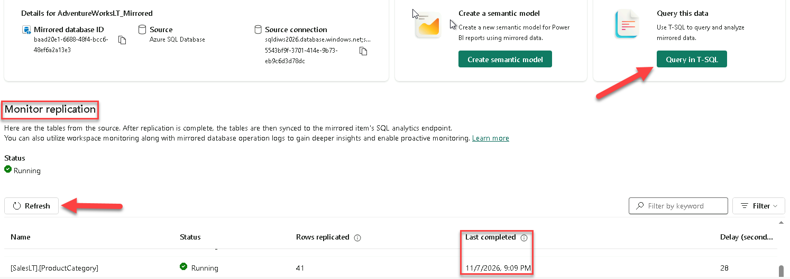
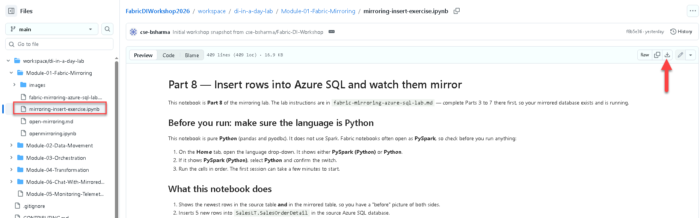

# Hands-On Lab: Mirroring Azure SQL Database into Microsoft Fabric

*Data Integration Workshop — Lab Guide*

## Lab Overview

Mirroring in Microsoft Fabric is a zero-ETL, SaaS capability that keeps a read-only, continuously replicated copy of an operational database in OneLake. In this lab you point Fabric at an Azure SQL Database that already holds the AdventureWorksLT sample data, start replication, and then query the mirrored tables from the SQL analytics endpoint without building a pipeline or a copy activity.

The environment for this workshop is already provisioned. Parts 1 and 2 are prerequisites that have been completed for you: Part 1 documents how the environment is wired, and Part 2 gives you the queries to confirm it. Parts 3 through 7 are the hands-on steps you perform in the Fabric portal, and Part 8 is an exercise you run from a Fabric notebook. Budget roughly 60 minutes; the initial snapshot of the AdventureWorksLT tables usually completes in two to five minutes.

Nothing in this lab changes the source database. Mirroring reads from the transaction log, and the replicated copy in Fabric is read-only.

## Lab Environment

The workshop resources and the mirroring prerequisites were provisioned by `setup_all.py` in the repository root. Replace each placeholder below (for example `<sql-server>`) with the value from `workshop_environment.md`, which the facilitator shares.

| Setting | Value |
| --- | --- |
| Azure subscription | `<subscription-id>` |
| Resource group and region | `<resource-group>`, `<region>` |
| SQL logical server | `sqldiws2026.database.windows.net` |
| Database | `sqldb-di-workshop-diuser1` (per-user AdventureWorksLT database — replace `diuser1` with your workshop user) |
| Fabric capacity | `fabriccapdiws` |
| Fabric workspaces | One per participant — yours is `<your-workspace>` |
| Data gateway | `vnetgw-di-workshop-2026` (VNet data gateway — the SQL server only has a private endpoint) |
| Setup script | `setup_all.py` (repository root) |

> **Workshop note:** The runnable notebook connects to Azure SQL as you, with your Microsoft Entra sign-in. No SQL passwords are shared.

## Part 1: Prerequisites Already Completed

Everything in this part is done. Read through it so you understand how the environment is wired, then use Part 2 to verify each item before you start clicking in the Fabric portal.

### Azure SQL Database with the sample data

Each workshop participant has a dedicated logical database `sqldb-di-workshop-{username}` on the server `sqldiws2026.database.windows.net` in the resource group and region. Each database was provisioned with the AdventureWorksLT sample, so the `SalesLT` schema and its tables are already populated. Mirroring requires a primary key on every table it replicates, and each `SalesLT` table meets that requirement.

### System assigned managed identity enabled on the logical server

The system assigned managed identity (SAMI) of the logical server is enabled and set as the primary identity. Fabric uses it to publish data into OneLake, so mirroring cannot start without it. The setup applied this with `az sql server update --assign_identity`; the same switch is available in the Azure portal under **Security → Identity** on the SQL server resource.

### Mirroring permissions for participants

You create the mirroring connection with your own workshop account, so Fabric reads the source database as you. `setup_all.py` added every workshop user to the **DI Workshop Participants** Microsoft Entra group and granted that group the permissions mirroring requires in each per-user database `sqldb-di-workshop-{username}`:

- `SELECT` (through the `db_datareader` role)
- `ALTER ANY EXTERNAL MIRROR`
- `VIEW DATABASE PERFORMANCE STATE`
- `VIEW DATABASE SECURITY STATE`

The statements that were run are reproduced here for reference; you do not need to run them:

```sql
-- in sqldb-di-workshop
CREATE USER [DI Workshop Participants] FROM EXTERNAL PROVIDER;
ALTER ROLE db_datareader ADD MEMBER [DI Workshop Participants];
ALTER ROLE db_datawriter ADD MEMBER [DI Workshop Participants];
GRANT ALTER ANY EXTERNAL MIRROR,
      VIEW DATABASE PERFORMANCE STATE,
      VIEW DATABASE SECURITY STATE
TO [DI Workshop Participants];
```

### Fabric capacity and workspace

The capacity `fabriccapdiws` exists in the same subscription, and each participant's workspace is assigned to it. Confirm the capacity is running before you begin, because it is paused automatically every night and replication stops while a capacity is paused.

Setup made you an **Admin** of your workspace. Mirroring needs the **Member** or **Admin** role: during creation Fabric grants the SQL server managed identity write permission on the mirrored database item, and the Contributor role does not carry the *Reshare* permission that step depends on.

### Fabric tenant settings

`setup_all.py` switches this tenant setting on when it is run by a Fabric administrator. Otherwise a Fabric administrator enables it once in **Settings → Admin portal → Tenant settings**:

- **Users can access data stored in OneLake with apps external to Fabric** — under *OneLake settings*.

Tenant setting changes can take up to fifteen minutes to propagate, so make this change before the lab session begins rather than during it.

### Notebook access to Azure SQL

The SQL server has no public endpoint. Setup created a **managed private endpoint** to it in every workshop workspace (**Workspace settings → Network security**), so notebooks in your workspace can reach it privately. Notebooks sign in to SQL as **you** with your Microsoft Entra account — setup added every workshop user to a participants group that has read and write access to `sqldb-di-workshop`. No SQL passwords are used.

Because the workspace uses a managed virtual network, notebook sessions start on demand rather than from a pre-warmed pool, so the first session in a notebook can take a few minutes to start.

### Networking

Fabric must be able to reach the Azure SQL logical server. The workshop server has public network access disabled and is reachable only through a private endpoint in the workshop virtual network, so the connection must use the virtual network data gateway `vnetgw-di-workshop-2026`.

## Part 2: Verify the Environment (Prerequisite — Already Completed)

This section is a pre-lab validation record. The checks have already been completed by setup; participants do not run these during the lab. Keep the queries here only for the facilitator if the environment ever needs to be revalidated.

1. Against the per-user database (e.g. `sqldb-di-workshop-diuser1`), confirm the managed identity is enabled and primary on the server. One row should come back with an identity type of `System-assigned`.

   ```sql
   SELECT * FROM sys.dm_server_managed_identities WHERE is_primary = 1;
   ```

2. Against your per-user database (e.g. `sqldb-di-workshop-diuser1`), confirm the sample tables are present.

   ```sql
   SELECT TABLE_SCHEMA, TABLE_NAME
   FROM INFORMATION_SCHEMA.TABLES
   WHERE TABLE_SCHEMA = 'SalesLT';
   ```

3. Still in your per-user database, confirm the participants group holds the mirroring permissions. You should see `ALTER ANY EXTERNAL MIRROR`, `VIEW DATABASE PERFORMANCE STATE` and `VIEW DATABASE SECURITY STATE` in the `GRANT` state (`SELECT` comes from the `db_datareader` role).

   ```sql
   SELECT dp.permission_name, dp.state_desc
   FROM sys.database_permissions dp
   JOIN sys.database_principals pr ON dp.grantee_principal_id = pr.principal_id
   WHERE pr.name = 'DI Workshop Participants';
   ```

If any check fails, re-run `setup_all.py` before continuing. Permissions granted through a group can take a few minutes to apply, so retry once before troubleshooting.

## Part 3: Create the Mirrored Database in Fabric

1. Open the Fabric portal at `app.fabric.microsoft.com` and switch to your workshop workspace, `<your-workspace>`.
2. Select **New item**, type `Mirror` into the search box, and select **Mirrored Azure SQL Database**.

   

Fabric opens the connection pane. You name the mirrored database later, in Part 5. Nothing is replicating yet at this point.

## Part 4: Connect to the Azure SQL Database

Fabric needs a connection to the logical server before it can read the transaction log and publish changes to OneLake.

1. Under **New sources**, select **Azure SQL Database**. If you already created a connection to this server, select it under **Existing connections** instead and skip ahead to Part 5.
2. Enter the connection details:
   - **Server:** `sqldiws2026.database.windows.net`
   - **Database:** `sqldb-di-workshop-diuserXX` (replace `diuserXX` with your workshop user number, e.g., `sqldb-di-workshop-diuser1`)
   - **Connection:** Create new connection with name `sqlmirrorcred`
   - **Data gateway:** `vnetgw-di-workshop-2026`
   - **Authentication kind:** **Organizational account** — sign in with your workshop user account when prompted. This lab does not use a service principal.
3. Select **Connect**.

> **💡 You'll reuse this connection.** The Copy Job in Module 2 — Data Movement reads from the same server and database, so it can select this connection instead of creating a new one.

A login failure here almost always means your account is missing the mirroring permissions, or a permission granted to the participants group has not applied yet. Return to Part 2 and re-run the checks.

## Part 5: Start Mirroring

The **Choose data** screen defaults to selecting all tables, which replicates every eligible table. It also defaults to **Automatically mirror future tables** so any new tables added to the source will be replicated to the destination.

1. Leave all tables selected, but note that to mirror a subset of tables simply select individual tables.
2. Select **Connect**.
3. Enter the destination name for the mirrored database, enter exactly `AdventureWorksLT_Mirrored`. Later parts and the Part 8 notebook look for this name — the notebook sets `MIRRORED_DB = "AdventureWorksLT_Mirrored"` in Cell 1, so use any other name and you must update that variable to match.
4. Select **Create mirrored database**.
Replication begins immediately. Fabric takes an initial snapshot of each table and then applies incremental changes continuously as they land in the source.

## Part 6: Monitor Replication

Fabric takes you to the mirroring status page as soon as replication starts.

1. Select the **Refresh** button below the **Monitor replication** heading.
2. Refresh the panel if the table list is still empty. The overall status changes to **Running** once the tables are synchronizing.
3. A timestamp in the **Last completed** column means the initial copy of that table has finished.

   

Rows replicated and last completed time are reported per table, so a single table stuck in a snapshot state is easy to spot without digging through logs.

## Part 7: Query the Mirrored Data

Every mirrored database comes with a SQL analytics endpoint and a default semantic model, so the replicated tables are queryable in Fabric as soon as the snapshot lands.

1. On the mirrored database status page, select **Query in T-SQL** under **Query this data** to open the SQL analytics endpoint of the mirrored database.

   
2. Select **New SQL query**, paste the following code, and select **Run**.

   ```sql
   SELECT TOP (100) CustomerID, CompanyName, SalesPerson
   FROM SalesLT.Customer
   ORDER BY CustomerID;
   ```

From here the data is available across the whole of Fabric. Shortcut it into a lakehouse, join it to other mirrored or lakehouse tables in a warehouse query, or build a Power BI report on the default semantic model in Direct Lake mode.

> **Note:** Granular security defined in the source database — row-level security, column-level permissions, dynamic data masking — does not travel with the mirror. Reapply it on the mirrored database in Fabric if the data calls for it.

## Part 8: Exercise — Insert and Delete from a Fabric Notebook

Parts 1 and 2 are prerequisites that are already complete, and Parts 3 to 7 got mirroring running and proved the initial snapshot. This exercise proves the incremental side: you insert and delete data in the source database and watch mirroring replicate those changes into OneLake on its own.

The exercise runs in a Fabric notebook using the **Python** engine. It doesn't use Spark. The source operations go through a **pyodbc** connection to Azure SQL as you, using a Microsoft Entra access token, over the workspace's managed private endpoint. The mirrored side is read through the mirrored database's SQL analytics endpoint, so you can compare both sides in one place and observe replication in action.

Because you have your own dedicated per-user database, there are no multi-user conflicts—you can safely insert and delete rows without affecting other participants.

1. Open the workshop GitHub repository at [https://aka.ms/fabric-di-workshop](https://aka.ms/fabric-di-workshop).
2. In the **Files** pane, browse to `workspace/di-in-a-day-lab/Module-01-Fabric-Mirroring` and select `mirroring-insert-exercise.ipynb`.
3. Select the **Download raw file** button at the top right of the file view to save the notebook to your computer.

   
4. In your workspace, select **Import** → **Notebook** → **From this computer**, and upload the `mirroring-insert-exercise.ipynb` file you just downloaded.
5. Open the notebook. On the **Home** tab, check the language drop-down. If it shows **PySpark (Python)**, select **Python** and confirm the switch.
6. In Cell 1, replace `diuser1` with your workshop user number (e.g., `diuser2`) to connect to your per-user database.
7. Run the cells in order. The first session can take a few minutes to start.

### Notebook cell flow

- Cell 1 sets the SQL server, database, and mirrored item; shows the account you're signed in as.
- Cell 2 connects to your per-user database with `pyodbc` and your Microsoft Entra access token, then shows the source row count before any changes.
- Cell 3 shows the same row count from the mirrored database's SQL analytics endpoint. They should match.
- Cell 4 inserts 5 new rows into `SalesLT.SalesOrderDetail` and displays them.
- Cell 5 waits for mirroring to replicate the inserts, then shows the row count on both source and mirror.
- Cell 6 deletes the inserted rows from the source.
- Cell 7 waits for mirroring to replicate the deletes, then confirms they're gone from the mirror.

### Insert step used in the notebook

```python
insert_sql = """
DECLARE @OrderID int = (
    SELECT TOP (1) SalesOrderID
    FROM SalesLT.SalesOrderHeader
    ORDER BY NEWID()
);

INSERT INTO SalesLT.SalesOrderDetail
    (SalesOrderID, OrderQty, ProductID, UnitPrice, UnitPriceDiscount)
SELECT TOP (5)
    @OrderID,
    1 AS OrderQty,
    ProductID,
    ListPrice,
    0.00
FROM SalesLT.Product
WHERE ListPrice > 0
ORDER BY NEWID();

SELECT COUNT(*) as RowCount FROM SalesLT.SalesOrderDetail;
"""
```

### Delete step used in the notebook

```python
delete_sql = """
-- Delete rows inserted in this exercise (the most recent 5 rows)
DELETE TOP (5) FROM SalesLT.SalesOrderDetail
WHERE SalesOrderDetailID IN (
    SELECT TOP (5) SalesOrderDetailID
    FROM SalesLT.SalesOrderDetail
    ORDER BY SalesOrderDetailID DESC
);

SELECT COUNT(*) as RowCount FROM SalesLT.SalesOrderDetail;
"""
```

### Notes for the facilitator

- `LineTotal` in `SalesOrderDetail` is a non-persisted computed column, so it is not replicated and will be missing from the mirrored table. Compute it in the Fabric query instead.
- The notebook signs in as the participant with a Microsoft Entra token; no passwords are stored or entered. Participants get read and write access through the workshop participants group.
- The notebook runs on the Python engine. It reads the mirror through the mirrored database's SQL analytics endpoint (`notebookutils.data.connect_to_artifact`), so it needs no Spark session and no attached lakehouse. It must run inside Fabric, because `notebookutils` and the managed private endpoint are only available there.
- Replication of inserts and deletes usually takes less than a minute.
- Since each user has their own database, there are no conflicts from concurrent notebook runs.

## Troubleshooting

| Symptom | What to check |
| --- | --- |
| **Mirror database** is unavailable, or creation fails with *Unable to grant the required permission to the source server … User does not have permission to reshare* | You need the Member or Admin role on the workspace (setup makes each participant Admin). Contributor lacks the Reshare permission Fabric needs to grant the SQL managed identity write access. |
| `Login failed for user '<token-identified principal>'` | Your account is not in the **DI Workshop Participants** group, or the group's database user is missing in your per-user database. Re-run the checks in Part 2 on your per-user database (e.g., `sqldb-di-workshop-diuser1`). |
| Mirroring fails with a missing permission such as `VIEW DATABASE SECURITY STATE` | The participants group is missing one of the mirroring permissions on your per-user database. Run check 3 in Part 2; the facilitator re-runs `setup_all.py` to grant them. |
| Mirroring starts, then stops replicating | The `fabriccapdiws` capacity is paused or deleted. Resume it in the Azure portal; no data replicates while a capacity is paused. |
| A table never leaves the snapshot state | The table has no primary key, or it uses a data type mirroring does not support. Deselect that table and mirror the rest. |
| The notebook fails with Spark errors, or a `PATH_NOT_FOUND` error for a `.mountedrelationaldatabase` path | You're running an older copy of the notebook. Import `mirroring-insert-exercise.ipynb` again and set the language to **Python**. |
| The notebook can't connect to SQL (timeout or login failure) | In **Workspace settings → Network security**, the managed private endpoint to `sqldiws2026` must show **Approved**, and your account must be in the workshop participants group. |
| Fabric cannot reach the logical server | The server has no public endpoint. Select the virtual network data gateway `vnetgw-di-workshop-2026` on the connection, and check that the gateway is running. |

## Wrap-Up

You now have a continuously replicated, read-only copy of the AdventureWorksLT sample database in OneLake, refreshed without a pipeline, a schedule or a copy activity. Leave mirroring running — later modules, including Module 6 (Chat with Mirrored Data), query the mirrored database. Pause the `fabriccapdiws` capacity if the environment is not needed again the same day. The `delete_all.py` script in the repository root tears down the entire workshop environment.

## Reference

- [Tutorial: Configure Microsoft Fabric mirrored databases from Azure SQL Database](https://learn.microsoft.com/en-us/fabric/mirroring/azure-sql-database-tutorial) — Microsoft Learn

---

**Next:** [Module 2 — Data Movement →](../Module-02-Data-Movement/)
