# Hands-On Lab: Data Movement into Microsoft Fabric OneLake

*Data Integration Workshop — Lab Guide*

## Lab Overview

Data movement is the foundation of every data integration solution. In this lab you use three distinct Microsoft Fabric capabilities to move operational, file, and streaming data from external sources into a single **Bronze** lakehouse in OneLake. Each method has its own strengths — by the end of the lab you will know when to reach for each one.

| Method | Best for | Load type | Source in this lab |
| --- | --- | --- | --- |
| **Copy Job** | Simplified bulk and incremental ingestion with CDC / watermark support | Full + Incremental | Azure SQL Database (`AdventureWorksLT`) |
| **Copy Activity** | Pipeline-embedded movement with rich mapping, staging, and parallelism | Full (and watermarked incremental) | ADLS Gen2 (NYC Taxi parquet) |
| **Eventstream** | Real-time event ingestion and routing, no code | Streaming | Fabric sample streaming source |

The environment for this workshop is already provisioned. Parts 1 and 2 are prerequisites that have been completed for you: Part 1 documents how the environment is wired, and Part 2 gives you the queries and checks to confirm it. Parts 3 through 7 are the hands-on steps you perform in the Fabric portal. Budget roughly 60 minutes.

Nothing in this lab is destructive to the source systems. The Copy Job and Copy Activity read from the source, and the incremental exercise only *inserts* new rows — it never updates or removes existing data, so multiple attendees can run the lab at the same time.

> **Fabric Mirroring is covered separately in [Module 1](../Module-01-Fabric-Mirroring/).** This module deliberately focuses on Copy Job, Copy Activity, and Eventstream so there is no overlap.

## Lab Environment

The workshop resources were provisioned by `setup_all.py`. Replace each placeholder below (for example `<sql-server>`) with the value from `workshop_environment.md`, which the facilitator shares. The relevant sources for this module are the Azure SQL Database, the ADLS Gen2 storage account, and your Fabric workspace.

| Setting | Value |
| --- | --- |
| Azure subscription | `<subscription-id>` |
| Resource group and region | `<resource-group>`, `<region>` |
| SQL logical server | `<sql-server>.database.windows.net` |
| Database | `sqldb-di-workshop-diuser1` (per-user AdventureWorksLT database — replace `diuser1` with your workshop user) |
| ADLS Gen2 storage account | `<storage-account>` (hierarchical namespace enabled) |
| Blob container / path | `opendatasets` → `nyctlc/yellow/` (NYC Taxi parquet files) |
| Fabric capacity | `fabriccapdiws` |
| Fabric workspaces | One per participant — yours is `<your-workspace>` |
| Tenant ID | `<tenant-id>` |
| Service principal (application ID) | `<lab-spn-client-id>` |
| Data gateway | `vnetgw-di-workshop-2026` — the SQL server and storage have private endpoints, so select this VNet data gateway on every SQL and ADLS connection |
| Target lakehouse (you create in Part 3) | `Contoso_Bronze_LH` |

> **Workshop note:** Use your own workspace (`<your-workspace>`) throughout. All items you create in this module land in that workspace, and the service principal credentials are supplied by the facilitator at the start of the session.

## Part 1: Prerequisites Already Completed

Everything in this part is done. Read through it so you understand how the environment is wired, then use Part 2 to verify each item before you start clicking in the Fabric portal.

### Azure SQL Database with the sample data

Each workshop participant has a dedicated database `sqldb-di-workshop-{username}` on the server `sqldiws2026.database.windows.net`, provisioned with the AdventureWorksLT sample. The `SalesLT` schema and its tables are already populated, and every `SalesLT` table carries a `ModifiedDate` column — that column is the watermark the Copy Job incremental exercise relies on.

### ADLS Gen2 storage with the NYC Taxi dataset

The storage account `<storage-account>` has hierarchical namespace enabled and holds a container named `opendatasets`. During setup, AzCopy loaded the public NYC Taxi (`nyctlc`) parquet files — the `yellow/` folder by default, plus any other folders the facilitator chose. This module uses the `nyctlc/yellow/` folder as the file source for Copy Activity.

### Fabric capacity and workspace

The capacity `fabriccapdiws` exists in the same subscription and each participant's workspace is assigned to it. Confirm the capacity is running before you begin, because it is paused automatically every night and Fabric items cannot run while a capacity is paused.

Setup made you an **Admin** of your workspace, so you can create the lakehouse, Copy Job, pipeline, and Eventstream items used in this module (Member or Admin is required).

### Fabric tenant settings

`setup_all.py` switches these two tenant settings on when it is run by a Fabric administrator; otherwise a Fabric administrator enables them once. They are the same settings used across the workshop:

- **Service principals can call Fabric public APIs** — under *Developer settings*, scoped to a security group that contains the workshop service principal.
- **Users can access data stored in OneLake with apps external to Fabric** — under *OneLake settings*.

Tenant setting changes can take up to fifteen minutes to propagate, so this is done before the session rather than during it.

### Notebook access to Azure SQL

The SQL server has no public endpoint. Setup created a **managed private endpoint** to it in every workshop workspace (**Workspace settings → Network security**), so notebooks in your workspace can reach it privately. Notebooks sign in to SQL as **you** with your Microsoft Entra account — setup added every workshop user to a participants group that has read and write access to each per-user database. No SQL passwords are used.

Because the workspace uses a managed virtual network, Spark sessions start on demand rather than from the starter pool, so the first session in a notebook can take a few minutes to start.

## Part 2: Verify the Environment (Prerequisite — Already Completed)

This section is a pre-lab validation record. The checks have already been completed by setup; participants do not run these during the lab. Keep the queries here only for the facilitator if the environment ever needs to be revalidated.

1. Against your per-user database (e.g. `sqldb-di-workshop-diuser1`), confirm the sample tables are present.

   ```sql
   SELECT TABLE_SCHEMA, TABLE_NAME
   FROM INFORMATION_SCHEMA.TABLES
   WHERE TABLE_SCHEMA = 'SalesLT';
   ```

2. Confirm the four tables used in this module carry a `ModifiedDate` watermark column.

   ```sql
   SELECT TABLE_NAME, COLUMN_NAME
   FROM INFORMATION_SCHEMA.COLUMNS
   WHERE TABLE_SCHEMA = 'SalesLT'
     AND COLUMN_NAME = 'ModifiedDate'
     AND TABLE_NAME IN ('Customer', 'Product', 'SalesOrderHeader', 'SalesOrderDetail');
   ```

3. Confirm the NYC Taxi parquet files are present in ADLS Gen2. From a machine with the Azure CLI signed in to the workshop subscription:

   ```bash
   az storage fs file list \
     --account-name <storage-account> \
     --file-system opendatasets \
     --path nyctlc/yellow \
     --query "[].name" -o tsv | head
   ```

If any check fails, re-run `setup_all.py` before continuing.

## Part 3: Create the Bronze Lakehouse

Every ingestion method in this module lands data in the same lakehouse, so create it first.

1. Open the Fabric portal at `app.fabric.microsoft.com` and switch to your workshop workspace, `<your-workspace>`.
2. Select **New item**, choose **Lakehouse**, and name it `Contoso_Bronze_LH`.
3. Select **Create**. Leave the lakehouse open — you will return to its **Tables** area to verify each ingestion.

> **✅ Checkpoint:** The `Contoso_Bronze_LH` lakehouse appears in your workspace with empty **Tables** and **Files** areas.

## Part 4: Exercise 1 — Copy Job (Full & Incremental Load)

**Time:** ~15 minutes
**Goal:** Use Copy Job to perform a full historical load from Azure SQL Database, then switch it to incremental so only changed rows are copied.

### What is Copy Job?

Copy Job is Fabric's preferred solution for simplified data movement. It natively supports **bulk copy**, **incremental copy**, and **CDC replication** through a wizard-driven experience — no pipeline authoring required. A single job can move multiple tables and be toggled between full and incremental modes.

### Exercise 1a — Full load

1. In your workspace, select **New item** → **Copy Job**.
2. Name it `CJ_SalesLT_Ingest`.
3. In the **Choose data source** step:
   - Select **Azure SQL Database**.

     > **💡 You most likely already have this connection.** The mirroring lab in Module 1 (Part 4) created a connection to this same server and database. If it appears under **Existing connections**, select it and go straight to choosing tables.

   - Otherwise, create a new connection to the source:
     - **Server:** `sqldiws2026.database.windows.net`
     - **Database:** `sqldb-di-workshop-diuser1` (replace `diuser1` with your workshop user number)
     - **Data gateway:** `vnetgw-di-workshop`
     - **Authentication kind:** Organizational account — sign in with your workshop user account when prompted.
   - Select the following tables:
     - `SalesLT.Customer`
     - `SalesLT.Product`
     - `SalesLT.SalesOrderHeader`
     - `SalesLT.SalesOrderDetail`
   - **Add audit columns.** Still on this step, enrich the rows of the table you'll modify in Exercise 1b with data-movement metadata. Audit columns are configured **per table**, so select **only `SalesLT.SalesOrderHeader`** in the table list and add **all** available audit columns **except `Custom`** and **`File path`** (a SQL source has no file path):
     - **Workspace ID**
     - **Copy job ID**
     - **Copy job run ID**
     - **Copy job name**
     - **Data extraction time**
     - **Lower bound**
     - **Upper bound**

     Leave the other three tables without audit columns, and leave **`Custom`** unselected — it only holds a user-defined static value, which this lab doesn't need.

     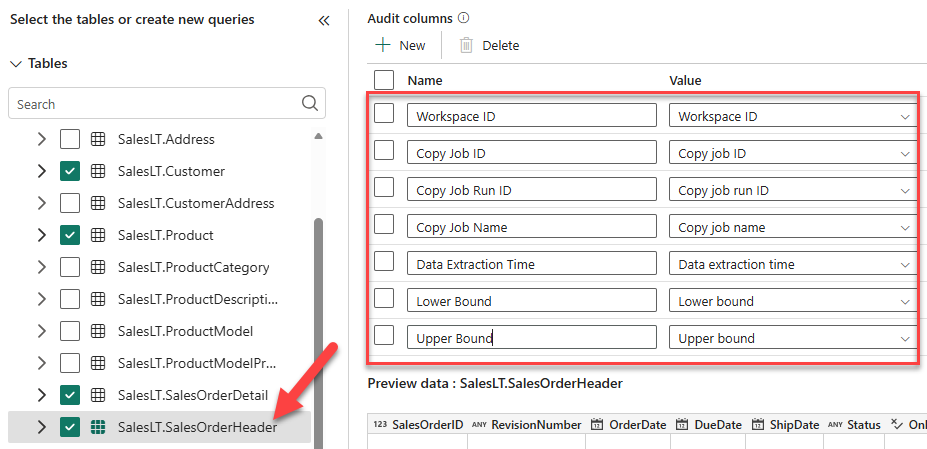
4. In the **Choose data destination** step:
   - Pick `Contoso_Bronze_LH` from the **OneLake catalog** section of the screen. Selecting it from the OneLake catalog attaches the job to your **existing** lakehouse — do **not** create a new lakehouse here.
   - Leave the **Connection settings** as they are. The **Connection (optional)** value of **(none)** uses your own permissions to access the lakehouse.

     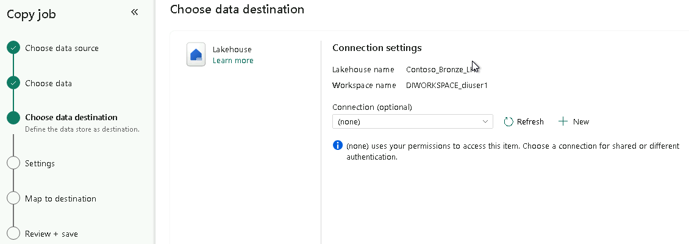
5. In the **Settings** step:
   - Set **Copy mode** to **Full copy**.
   - Verify the destination **root folder** is set to **Tables** (so the data lands as managed lakehouse tables, not files).
   - Set the **write method** to **Append**.
6. In the **Map to destination** step (this appears **after** Settings):
   - Accept the **default table mappings** — the source table names carry over to the destination.
   - Leave the **column mappings** at their defaults as well; no edits are needed.
7. Select **Save + Run** and monitor the run from the Copy Job detail page.
8. Switch to the `Contoso_Bronze_LH` lakehouse (for example, select its tab at the top of the Fabric portal). In the **Explorer**, hover your mouse to the right of **Tables**, select the **...** (three dots) menu, and select **Refresh** to see your newly loaded tables and the `SalesLT` schema.
9. Select the `SalesOrderHeader` table to preview its data, then scroll all the way to the right to see the new audit columns. The **Lower bound** and **Upper bound** columns are empty because you haven't run an incremental load yet.

   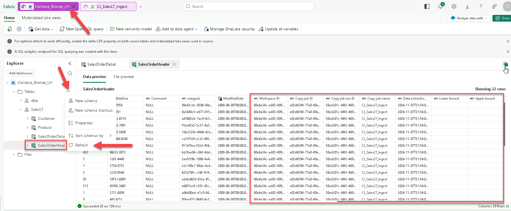

> **✅ Checkpoint:** All four tables appear under **Tables** in `Contoso_Bronze_LH` with their full row counts, and `salesorderheader` includes the audit columns you added (for example **Copy job name** and **Data extraction time**).

### Exercise 1b — Incremental load (watermark)

1. Open the `CJ_SalesLT_Ingest` Copy Job.
2. Select **Advanced settings**, open **Read settings**, and set the copy mode to **Incremental copy**.
3. For each table, set the **incremental column** to `ModifiedDate`. Copy Job stores the last watermark automatically between runs.
4. Select **Apply**. Copy Job warns that changing these settings resets the job:

   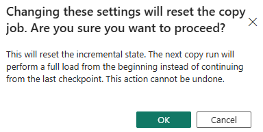

   This is expected. **The first run of an incremental copy performs a full load to establish the baseline** — every run *after* that copies only new or changed rows. Select **OK**, then select **Run** to perform that baseline full load.

5. Now insert some new rows in the source so the *next* run has changes to pick up. You don't need a local SQL client — a Fabric notebook connects to your per-user database as your signed-in user and inserts five rows into `[SalesLT].[SalesOrderHeader]`. Because you have your own dedicated database, there are no conflicts with other participants:

   1. Open the workshop GitHub repository at [https://aka.ms/fabric-di-workshop](https://aka.ms/fabric-di-workshop).
   2. In the **Files** pane, browse to `workspace/di-in-a-day-lab/Module-02-Data-Movement` and select `insert-sales-orders.ipynb`.
   3. Select the **Download raw file** button at the top right of the file view to save the notebook to your computer.
   4. In your workspace, select **Import** → **Notebook** → **From this computer**, and upload the `insert-sales-orders.ipynb` file you just downloaded.
   5. Open the notebook. In Cell 1, change the `SQL_DATABASE` value from `sqldb-di-workshop-diuserXX` to your database name (replace `diuserXX` with your workshop user number, e.g., `sqldb-di-workshop-diuser1`).
   6. Select **Run all**.
   7. Confirm the output lists the five inserted `SalesOrderID` values.
6. Back on the Copy Job, select **Run** to trigger it again.
7. Confirm that **only the new rows** were copied — the run summary shows rows read/written on `SalesLT.SalesOrderHeader` and zero on the unchanged tables:

   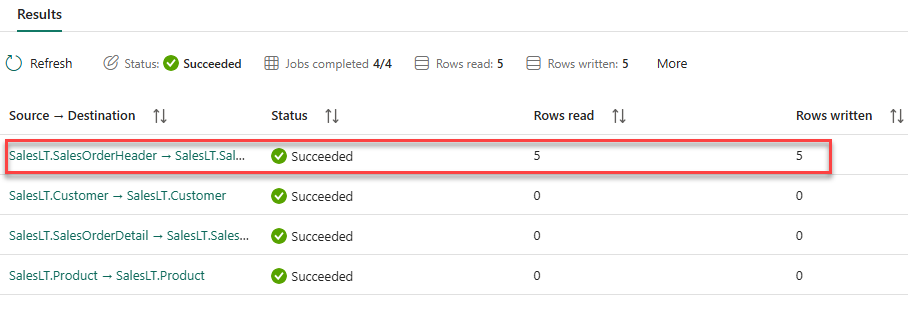

> **✅ Checkpoint:** `SalesLT.SalesOrderHeader` in the lakehouse contains the new orders, and the incremental run copied only the changed rows rather than re-copying every table.

### Verify the loaded data in the lakehouse

With the Copy Job finished, go back to the lakehouse and confirm the data actually landed.

1. In your workspace, open the `Contoso_Bronze_LH` lakehouse.
2. In the **Explorer**, expand **Tables**, then expand the **SalesLT** schema and confirm all four tables are present: `Customer`, `Product`, `SalesOrderDetail`, and `SalesOrderHeader`.
3. Select `Customer` to preview its rows and confirm the data loaded.
4. Select `SalesOrderHeader` and confirm the **audit columns** you added appear alongside the business columns — for example **Workspace ID**, **Copy Job ID**, **Copy Job Run ID**, **Copy Job Name**, and **Data Extraction Time**. (The other three tables won't have audit columns.)

   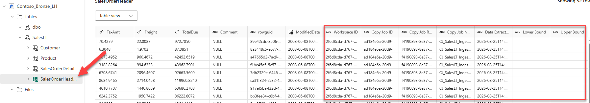

5. Switch to the **SQL analytics endpoint** (top-right of the lakehouse) and validate the incremental load by selecting the five rows the notebook inserted. They're tagged in `Comment` with your SQL user name, so `SUSER_NAME()` returns just your rows — no editing required:

   ```sql
   SELECT *
   FROM [SalesLT].[SalesOrderHeader]
   WHERE Comment = SUSER_NAME()
   ```

> **✅ Checkpoint:** All five rows you inserted (tagged with your user name in `Comment`) are returned — proof the incremental run carried the newly inserted data through — and each row carries the audit columns generated by the Copy Job.

### Key takeaways — Copy Job

- **Wizard-driven:** select source, select tables, select destination — no pipeline needed.
- **Full and incremental in one job:** toggle **Copy mode** and pick a watermark column.
- **Multi-table:** move several tables in a single job.

## Part 5: Exercise 2 — Copy Activity (Pipeline-Based File Ingestion)

**Time:** ~15 minutes
**Goal:** Use the Copy Activity inside a Data Factory pipeline to move NYC Taxi parquet files from ADLS Gen2 into the lakehouse.

### What is Copy Activity?

Copy Activity is the data-movement workhorse in Data Factory. Embedded within a pipeline, it moves data from 50+ sources to 40+ destinations with full control over parallelism, staging, and column mapping. Copy Activity always runs **as part of a pipeline**, so it can be combined with other activities for richer orchestration. Copy Job, by contrast, can run **independently** or be easily orchestrated inside a pipeline as well — the key difference is that Copy Activity *requires* a pipeline, whereas Copy Job does not.

### Steps

1. In your workspace, select **New item** → **Data pipeline**. Name it `PL_CopyActivity_NycTaxi`.
2. On the toolbar, select the drop-down on the **Copy data** button and choose **Add copy data activity** to add a Copy activity to the pipeline canvas.

   > **Careful — two choices:** the drop-down lists both **Add copy data activity** and an option with **Job** in its name. Select the one **without** *Job*. The *Job* option adds a **Copy Job** activity (what you built in Exercise 1) — it's simply one way to orchestrate a Copy Job inside a pipeline if you ever need to, but it's not what this exercise uses.
3. Configure the **Source**:
   - Select the **Source** tab, open the **Connection** drop-down, and choose **Browse all**.
   - In the **Get data** search box, type `lake` and select **Azure Data Lake Storage Gen2**.

     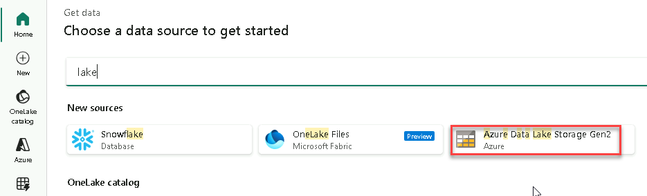
   - Create a new connection to ADLS Gen2:
     - **URL:** `https://adlsdiws.dfs.core.windows.net/`
     - **Data gateway:** `vnetgw-di-workshop-2026`
     - **Authentication kind:** **Organizational account** — sign in with your workshop user account when prompted.

     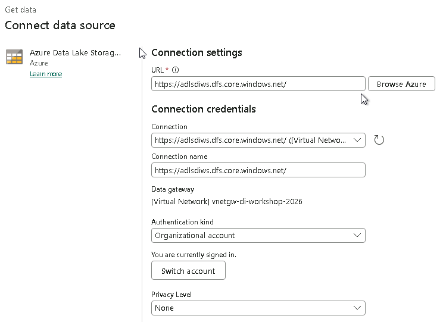
   - **File system:** `opendatasets`
   - **Directory:** `nyctlc/yellow`
   - **File format:** **Binary** — this exercise does a straight binary file copy, with no parsing or schema.
   - Enable **Recursively** to include all files in the folder.

     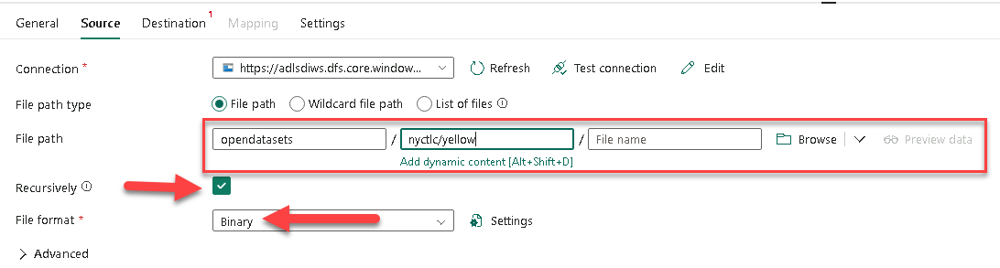
4. Configure the **Destination** (sink):
   - Open the **Connection** drop-down and select **Browse**, then choose the `Contoso_Bronze_LH` lakehouse from the **OneLake catalog** section.
   - **Root folder:** **Files**.
   - **Directory:** `nytaxi`
   - **File format:** **Binary**.
   - **Copy behavior:** **Preserve hierarchy** — keeps the source folder structure and file names intact.

   > **Why a binary copy?** Copying the files as-is (Binary) performs much better than parsing them into a table during ingestion. Once the files are in the lakehouse **Files** area, you can load them into a table whenever you like — right-click the folder and choose **Load to Tables**, or do it programmatically from a notebook.

      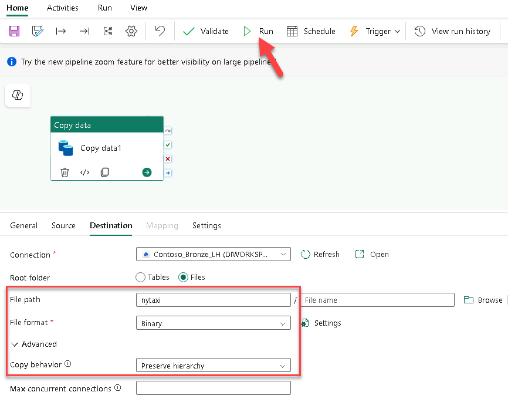
   5. Select **Run** and monitor execution on the **Output** tab.

> **✅ Checkpoint:** Open `Contoso_Bronze_LH`, expand **Files → nytaxi**, and confirm the NYC Taxi parquet files copied over with their original folder hierarchy and file names preserved.

### Bonus — incremental copy with a watermark

For a file source that receives new or updated files over time, you can copy incrementally by each file's **last modified** timestamp instead of a table column. Add a **Lookup** activity before the Copy activity to read the last watermark (the previous run time) from a small control table, set it as the Copy source's **Filter by last modified → Start time** so only files changed since then are copied, then add a **Stored procedure** activity after the Copy to update the watermark to the current run time. This is the file-based equivalent of the Copy Job incremental mode from Part 4 — and Copy Job turns this same last-modified pattern into a built-in toggle.

### Key takeaways — Copy Activity

- **Pipeline-embedded:** combine with other activities for multi-step workflows.
- **Rich configuration:** column mapping, fault tolerance, parallelism, and staging.
- **Broad connectivity:** 50+ source and 40+ destination connectors.

## Part 6: Exercise 3 — Eventstream (Real-Time Ingestion)

**Time:** ~15 minutes
**Goal:** Create an Eventstream that ingests a real-time sample event feed and lands it in the lakehouse in near real time.

### What is Eventstream?

Eventstream, part of Fabric's Real-Time Intelligence experience, enables **no-code real-time ingestion, transformation, and routing**. It connects to sources such as Azure Event Hubs, Kafka, and CDC-enabled databases, and routes events to destinations like Eventhouse, Lakehouse, Activator, and custom endpoints. This lab uses the built-in **sample data** source so no Event Hubs namespace is required.

### Steps

1. In your workspace, select **New item** → **Eventstream**. Name it `ES_Realtime_Ingest`.
2. Select **Add source** → **Sample data**.
   - Set the source **Name** to `YellowTaxi` and choose the **Yellow Taxi** sample dataset, then select **Add**. Events begin flowing immediately.
3. Add a **Filter** transformation to keep only longer trips:
   - On the button bar, select **Transform events** → **Filter**.
   - Set the **Operation name** to `Trip_GT_1mile`.
   - On the canvas, connect the stream to the `Trip_GT_1mile` filter by dragging from the output of the stream node to the filter node. You must do this before you can set the condition.
   - Add the condition `trip_distance` **>** `1` so only trips greater than 1 mile pass through.

     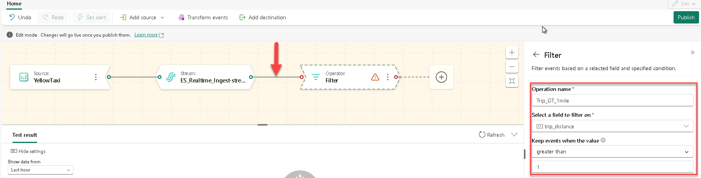
   - Select **Save**.
4. Add a destination:
   - Select **Add destination** → **Lakehouse** → `Contoso_Bronze_LH`.
   - For the **Delta table**, choose **Create new table**, create a new schema named `yt`, and name the table `trips` (giving you `yt.trips`).
   - **Input data format:** **Json**
   - Select **Save**.

     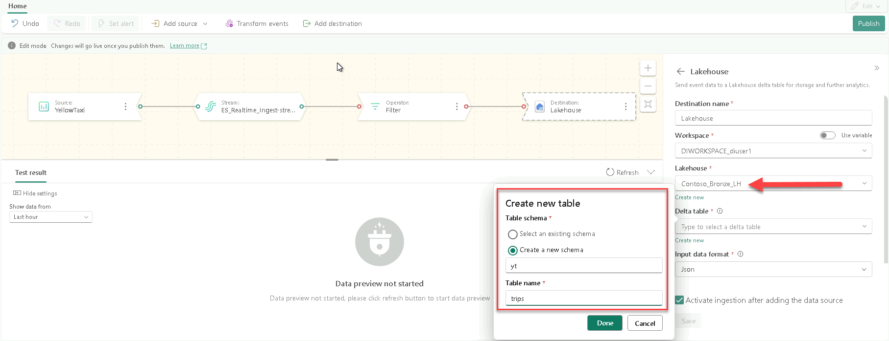
5. **Connect the filter to the destination.** On the canvas, drag from the output of the `Trip_GT_1mile` filter node to the Lakehouse destination node so the filtered events flow into it.
6. Select **Publish** to activate the Eventstream, then watch events flow through the **YellowTaxi** source → **Trip_GT_1mile** filter → **Lakehouse** destination on the canvas.

> **✅ Checkpoint:** The `yt.trips` table in `Contoso_Bronze_LH` grows continuously. From the lakehouse SQL analytics endpoint, run this twice a few seconds apart — the count increases:
>
> ```sql
> SELECT COUNT(*) AS trip_count FROM yt.trips;
> ```
>
> Then confirm the filter worked. Because only trips greater than 1 mile were kept, this returns **0**:
>
> ```sql
> SELECT COUNT(*) AS short_trips FROM yt.trips WHERE trip_distance < 1;
> ```

When you are done, select **Stop** on the Eventstream so it does not keep consuming capacity.

### Key takeaways — Eventstream

- **Real-time:** ingest streaming data as it arrives, with no batch schedule.
- **No code:** visual source → transform → destination canvas.
- **Multiple destinations:** route the same stream to Eventhouse, Lakehouse, Activator, and custom endpoints at once.

## Part 7: Compare the Methods

You have now landed relational, file, and streaming data into one Bronze lakehouse using three different tools. Use this table to choose the right one in real projects.

| Method | When to use | Load pattern | Complexity |
| --- | --- | --- | --- |
| **Copy Job** | Simple multi-table ingestion with built-in full / incremental / CDC | Full · Incremental | Low |
| **Copy Activity** | Pipeline-embedded movement with rich mapping and orchestration | Full · Incremental (watermark) | Medium |
| **Eventstream** | Real-time streaming ingestion and routing | Streaming | Medium |

### Decision framework

- **Just move tables quickly?** → **Copy Job**
- **Building a multi-step pipeline?** → **Copy Activity** (inside a pipeline)
- **Ingesting real-time events?** → **Eventstream**
- **Need a live replica of a database?** → **Mirroring** (see [Module 1](../Module-01-Fabric-Mirroring/))

## Troubleshooting

| Symptom | What to check |
| --- | --- |
| The notebook can't connect to SQL (timeout or login failure) | In **Workspace settings → Network security**, the managed private endpoint to `<sql-server>` must show **Approved**. Your account must be in the workshop participants group; ask the facilitator to re-run `setup_all.py` if not. |
| Copy Job or pipeline creation is unavailable | You need the Member or Admin role on the workspace, and the `fabriccapdiws` capacity must be running (not paused). |
| ADLS Gen2 connection is rejected | Confirm the DFS URL `https://<storage-account>.dfs.core.windows.net`, the `opendatasets` file system, and that your account has read access to the storage. |
| Copy Activity copies no files | The source **File system** must be `opendatasets` and **Directory** `nyctlc/yellow`, with **Recursively** enabled and **File format** set to **Binary**. |
| Incremental Copy Job re-copies every row | The incremental column must be set to `ModifiedDate`; the first incremental run establishes the baseline watermark, so changes are only detected from the second run onward. |
| Eventstream shows no data in the lakehouse | The Eventstream must be **Published** and started, and the destination delta table format set to **Json**; allow a minute for the first micro-batch to land. |

## Wrap-Up

You moved data into OneLake three different ways and can now articulate the trade-offs between them: Copy Job for simple full and incremental table loads, Copy Activity for pipeline-embedded file ingestion with rich control, and Eventstream for real-time streaming. All three landed in the `Contoso_Bronze_LH` lakehouse, ready for the transformation work in later modules.

Stop the Eventstream from its context menu when the lab is over, and pause the `fabriccapdiws` capacity if the environment is not needed again the same day. The `delete_all.py` script in the repository root tears down the entire workshop environment.

## Reference

- [Microsoft Fabric decision guide: copy activity, Copy job, dataflow, Eventstream, or Spark](https://learn.microsoft.com/en-us/fabric/fundamentals/decision-guide-pipeline-dataflow-spark) — Microsoft Learn
- [What is Copy job in Data Factory for Microsoft Fabric](https://learn.microsoft.com/en-us/fabric/data-factory/what-is-copy-job) — Microsoft Learn
- [How to copy data using Copy activity](https://learn.microsoft.com/en-us/fabric/data-factory/copy-data-activity) — Microsoft Learn
- [Introduction to Eventstreams in Microsoft Fabric](https://learn.microsoft.com/en-us/fabric/real-time-intelligence/event-streams/overview) — Microsoft Learn

---

**Previous:** [← Module 1 — Fabric Mirroring](../Module-01-Fabric-Mirroring/)  
**Next:** [Module 3 — Orchestration →](../Module-03-Orchestration/Module-03-Orchestration.md)
