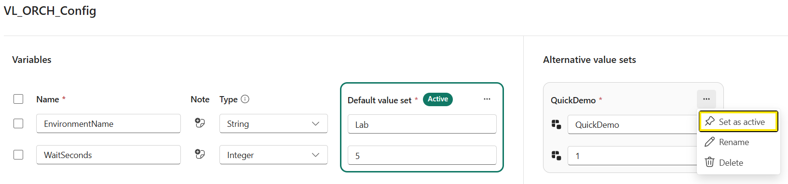

# Module 3 — Orchestration with Data Pipelines and Apache Airflow

| | |
|---|---|
| **Duration** | ~60 minutes, excluding environment provisioning and optional extensions |
| **Objective** | Build a reusable workflow and learn to coordinate its execution with both visual Data Pipelines and Python-based Apache Airflow |
| **Skills** | Pipeline basics · Parameters · Variable Library · Workspace identity · Conditions · ForEach · Dynamic task mapping · XCom · Retries |

---

## Overview

How do you turn individual tasks into a workflow you can trust? **Orchestration** puts you in control: you decide what runs, when tasks can run together, and what happens when something goes wrong.

In this module, you'll build a small, reusable pipeline and give it **two ways to run**: a visual Data Pipeline and a Python-based Apache Airflow workflow. You'll send each run its own instructions, coordinate several runs in parallel, and deliberately trigger a failure to see how retries and dependencies behave. By building the same pattern both ways, you'll discover where each approach shines.

### What you'll build

Start with a **child pipeline**: a reusable unit of work that accepts inputs, simulates a task, and reports success or a deliberate failure. Then build two **parents** that coordinate that work. Each parent calls the same child once for each work item, rather than duplicating the child's logic.

```text
          VISUAL APPROACH                  CODE-FIRST APPROACH
    +---------------------------+    +---------------------------+
    | Data Pipeline parent      |    | Apache Airflow parent     |
    | PL_ORCH_Parent            |    | AF_ORCH_Parent             |
    |                           |    |                           |
    | Use visual expressions    |    | Use Python code           |
    | Fan out with ForEach      |    | Fan out with task mapping |
    +-------------+-------------+    +-------------+-------------+
                  |                               |
                  +---------------+---------------+
                                  |
                     Both invoke the same child
                     with inputs for each run
                                  |
                                  v
                    +---------------------------+
                    | Reusable child pipeline   |
                    | PL_ORCH_Child             |
                    |                           |
                    | Receive inputs            |
                    | Choose a path             |
                    | Simulate work or fail     |
                    +-------------+-------------+
                                  |
                                  v
                    Observe the result, inspect
                    failures, and explore retries
```

### What you'll learn by doing

- **Design reusable workflows:** Separate the work itself from the parent that coordinates it, so the same child can serve different orchestration approaches.
- **Make each run flexible:** Pass parameters, write expressions and Python, and use a Variable Library to manage shared pipeline configuration.
- **Control execution:** Choose whether work should run, set task dependencies, and compare parallel ForEach with Airflow's dynamic task mapping.
- **Handle failures with confidence:** Test an intentional failure, explore retries, and ensure a parent waits for the child's actual result.
- **Connect without managing secrets:** Use workspace identity to authenticate both parents, and exchange small task inputs through Airflow's XCom.

These are patterns you can later apply to ingestion, transformation, and other data tasks. Here, a short **Wait** activity stands in for real work, keeping your attention on how the workflow behaves. `Customer`, `Product`, and `SalesOrderHeader` are simply labels for the three work items; no source tables are queried or changed.

**You can start with this module:** you'll create its items in your workshop workspace without needing to complete another module. If you'd like to take the pattern further, the optional extensions add a real Copy activity and an inactive Dataflow step to show where data movement and transformation fit.

### Learning path

| Part | Time | Outcome |
|---|---|---|
| 1. Workspace identity and environment | ~5 min | Secretless authentication and a ready workspace |
| 2. Pipeline basics: reusable child | ~10 min | A runnable, parameterized child with success and failure paths |
| 3. Visual parent and Variable Library | ~20 min | Conditional execution, parallel ForEach, expressions, and retries |
| 4. Airflow parent | ~25 min | The same child invoked using Python, XCom, and dynamic task mapping |
| Optional extensions | Additional time | Real Copy activity and an inactive transformation placeholder |

---

## Part 1 — Prepare Your Workspace and Identity

### What setup provides

Use `<your-workspace>` and the deployment values in the workshop environment handout. The default workspace name is `DIWORKSPACE_<your user name>`. 

<p align="center">
  
</p>


### Enable workspace identity

1. Open **Workspace settings 
<p align="center">
  
</p>

2. Select **Workspace identity** and create the identity.
<p align="center">
  
</p>

3. Record its name and application/object IDs; then close Workspace Settings.
<p align="center">
  
</p>

4. Open **Manage access**
<p align="center">
  
</p>

5. Select **Add people or groups**
<p align="center">
  
</p>


6. Search and Select the Workspace Identity you created in Step 2. Click on the dropdown and select the **Admin** role assignment. Then select **Add**. Finally select **X** to close this panel. 
<p align="center">
  
</p>


---
## Part 2 — Pipeline Basics: Create the Child

**Goal:** Build and test a small unit of work before either parent invokes it.

### Step 1 — Create parameters and a variable

1. Select **New item**. Seach for 'Pipeline'. Select on **Pipeline**.
<p align="center">
  
</p>


2. Name the Pipeline `PL_ORCH_Child`, then select **Create**.
<p align="center">
  
</p>


3. Select **Pipeline activity**, then select **Set variable**.
<p align="center">
  
</p>


4. Set the **Name** field to `Set_Started`.
<p align="center">
  
</p>

```text
Note: To access many of the Pipeline options and capabilities, you first need to add an Activity to the Authoring Canvas then click any empty space within the Authoring Canvas to show the options panel. 
```
5. Click anywhere in the **Authoring Canvas** to display the **Options Panel**
<p align="center">
  
</p>


6. In the **Parameters** tab, create the Pipeline Parameters by selecting **New** three times then provide the values below. 


   | Name | Type | Default |
   |---|---|---|
   | `work_item` | String | `Customer` |
   | `wait_seconds` | Int | `5` |
   | `force_failure` | Bool | `false` |

<p align="center">
  
</p>

7. Select on the **Variables** tab and select **New** to create a Pipeline Variable. Set **Name** to `status_message` and **Type** to **String**

<p align="center">
  
</p>


```text
Parameters are inputs to one run. 
Variables are mutable state within that run. 
Neither is a workspace-wide configuration store.
```

### Step 2 — Add expressions and conditional paths

1. Select the **Set variable** activity named `Set_Started`. Then select the tab **Settings**, and choose `status_message` from the dropdown then click inside the **Value textbox to display the link **Add dynamic content**. This will open the Pipeline expression builder**. 
<p align="center">
  
</p>


2. Add the following expression then select **OK**

   ```text
   @concat('Started: ', pipeline().parameters.work_item, '; run=', pipeline().RunId)
   ```

<p align="center">
  
</p>


3. Select on **Activities** tab in the top-left corner, then click **If conditions** to add an **If Condition** Activity to the Authoring Canvas. Set the **Name** field to `If_ForceFailure`
<p align="center">
  
</p>


4. Connect the `Set_Started` Set Variable Activity to the **If Condition** activity by clicking on the **On Success**, green checkmark, and dragging the line to the **If Conditon** activity. Select on the **If Condition** activity to display its options panel. 
<p align="center">
  
</p>


5. Select the **Activties** tab of the **If Condition** activity and set the condition to by adding the follow to the **Expression** field:

   ```text
   @pipeline().parameters.force_failure
   ```
<p align="center">
  
</p>


6. In the table, select the **Pencil** icon for the row where **Case** is **True** to drill-down into the **True** branch of the **If Condition**
<p align="center">
  
</p>


7. Select on the **Activities** tab in the top-left hand corner then select on the **All Activities** to open the drop-down of activities. Then select on **Fail** to add a **Fail Activity** to the **Authoring Canvas**
<p align="center">
  
</p>


 8. In the **General** tab of the **Fail Activity**, specify `Fail_Requested` for the **Name** field.
<p align="center">
  
</p>

9. Select on the **Settings** tab of the **Fail Activity** and add the below values to the fields:


   - **Fail message**:

     ```text
     @concat('Deliberate failure for ', pipeline().parameters.work_item)
     ```
   - **Error code:** `ORCH_DEMO_FAILURE`

<p align="center">
  
</p>

10. At the top-left hand corner of the **Authoring Canvas**, select on **Main canvas** to navigate out of the **True** case of the **If Activity** and back to the main authoring canvas. 
<p align="center">
  
</p>


11. Select on the **If Activity** in the **Authoring Canvas** then select on the **Activities (1)** tab. In the table, select the **Pencil** icon for the row where **Case** is **False** to drill-down into the **False** branch of the **If Condition**
<p align="center">
  
</p>


12. Select on the **Activities** tab in the top-left hand corner then select on the **All Activities** to open the drop-down of activities. Then select on **Wait** to add a **Wait Activity** to the **Authoring Canvas**.

13. In the **General** tab of the **Wait Activity**, specify `Wait_SimulatedWork` for the **Name** field.

14. Select on the **Settings** tab of the **Wait Activity** and set **Wait time in seconds** to 
      ```text
      @pipeline().parameters.wait_seconds
      ```

15. Select on the **Activities** tab in the top-left hand corner then select on **Set variable** to add a **Set variable  Activity** to the **Authoring Canvas**

16. In the **General** tab of the **Set variable Activity**, specify `Set_Completed` for the **Name** field.

17. Connect the **Wait activity** to the `Set_Completed` **Set variable Activity** by clicking on the **Wait activity**'s **On Success**, green checkmark, and dragging the line to the **Set variable Activity**. Select on the **Set variable Activity** to display its options panel. 

18. Select on the **Settings** tab then select on the drop-down for the **Name** fild. Select `status_message`.
   - Set **Value** to:

     ```text
     @concat('Completed: ', pipeline().parameters.work_item)
     ```


### Step 3 — Save, run, and inspect

1. **Save** and **Run** with the defaults.
<p align="center">
  
</p>
<p align="center">
  
</p>

2. In **Output**, inspect activity input/output, duration, and run ID. Confirm `Set_Completed` records `Completed: Customer`.


<p align="center">
  
</p>

3. Run again with `work_item = Product` and `force_failure = true`.
4. Confirm the run is **Failed** with `ORCH_DEMO_FAILURE`; the Wait path must not run.
5. Run once more with `force_failure = false` and confirm success.


---

## Part 3 — Visual Parent: Configuration, Conditions, and Concurrency

### Step 1 — Create a Variable Library

1. In your workspace, select **New item → Variable library**.
2. Name it `VL_ORCH_Config`.
3. Add:

   | Name | Type | Default value |
   |---|---|---|
   | `EnvironmentName` | String | `Lab` |
   | `WaitSeconds` | Integer | `5` |

4. Add an alternative value set named `QuickDemo`:
   - `EnvironmentName = QuickDemo`
   - `WaitSeconds = 1`
5. Keep the default set active initially, and **Save**.


<p align="center">
  
</p>

```text
The library holds shared configuration, not secrets or mutable counters. Changing its active value set affects referencing items in the workspace; each participant uses their own workspace.
```


### Step 2 — Create the parent

1. Create a data pipeline named `PL_ORCH_Parent`.
2. Select on the **Activities** tab, select **ForEach** to add a **ForEach Activity** to the **Authoring Canvas**, and set its **Name** to `ForEach_WorkItem`. Don't configure it yet — you'll do that in Step 3. Like the child pipeline, the parent needs an activity on the canvas before the pipeline-level options are available.
3. Click any empty space in the **Authoring Canvas** to display the **Options Panel**.
4. Add **Parameters**:

   In the Parameters tab of the Data Pipeline Options, select `New` and add the following:
   | Name | Type | Default |
   |---|---|---|
   | `work_items` | Array | `["Customer", "Product", "SalesOrderHeader"]` |
   | `run_children` | Bool | `true` |
   | `fail_item` | String | Empty string |

5. Add a variable named `summary` with the type **String**.
6. In the Pipeline's Options Panel, select the **Library variables** tab, add references to `EnvironmentName` and `WaitSeconds` from `VL_ORCH_Config`. Name the local references `EnvironmentName` and `WaitSeconds`.

```text
Note: You will need to add each reference one at a time
```

<p align="center">
  
</p>

<p align="center">
  
</p>


### Step 3 — Add ForEach with a nested conditional execution

1. Select the `ForEach_WorkItem` activity you added in Step 2 to display its settings.
2. Configure:
   - **Items:** `@if(equals(pipeline().parameters.run_children,true),pipeline().parameters.work_items,array(''))`
   - **Sequential:** Off `the default`
   - **Batch count:** `2`

<p align="center">
  
</p>


3. In the **ForEach** activity, add an **If Condition** activity named `If_RunChildren`.
4. Set its expression to `@pipeline().parameters.run_children`.
5. In its **False** case, add `Set_Disabled` (**Set variable**):
   - Variable: `summary`
   - Value: `Child execution disabled by run_children`
 

> Data Pipelines do not support nested looping activities or inside conditionals. However, we can have conditionals inside loops and can leverage Expression Builder to pass in a single indexed array when  run_children is false.

### Step 4 — Invoke the child using workspace identity

> Note: We will add an Invoke Pipeline Activity to the True case of the If Condition activity. An Invoke Pipeline Activity leverages a Fabric Connection. Before we edit the True case, we need to create this connection outside of the Data Pipeline, then come back. We are doing this to expose additional Connection Properties that are needed in the Airflow portion of this lab. 

1. Navigate to Fabric **Settings** (top-right cogwheel):
   -  Navigate to `Manage Connection and gateways`.
      - Select `New`
      - Select `Cloud`
      - Name the connection `CN_ORCH_PipelineWI_<your user name>`
      - Connection Type `Fabric Data Pipelines`
      - Authentication Method `Workspace Identity`
         - Enable `Allow Code-First Artifacts like Notebooks to access this connection`
      - Select `Create` 


<p align="center">
  
</p>


<p align="center">
  
</p>


<p align="center">
  
</p>


2. Back in the Data Pipeline, in its **True** branch, add an **Invoke pipeline** activity (not **Invoke pipeline (Legacy)**).

3. Name it `Invoke_Child`.

4. Use a Fabric connection named `CN_ORCH_PipelineWI_<your user name>`
   - **Workspace:** Your workspace
   - **Pipeline:** `PL_ORCH_Child`
   - **Wait on completion:** Enabled
   - Update the **Parameters**, **Value** fields with:

   | Child parameter | Parent expression |
   |---|---|
   | `work_item` | `@item()` |
   | `wait_seconds` | `@pipeline().libraryVariables.WaitSeconds` |
   | `force_failure` | `@equals(item(), pipeline().parameters.fail_item)` |


<p align="center">
  
</p>


6. Under **General**, select **Enable retries**, set **Retry** to `1`, select **Fixed** for **Retry interval type**, and set **Retry interval (sec)** to `30`. Leave retry conditions unset so the deliberate failure is retried.

Waiting for completion is essential: a successful submission is not the same as a successful child run. Retrying Invoke can submit another child run. That is harmless for Wait, but real data operations must be designed for repeat execution.

<p align="center">
  
</p>


> **Parallel-variable rule:** Do not Set a shared parent variable inside the parallel ForEach. Pipeline variables are scoped to the pipeline run, not to each iteration, and concurrent writes are unsafe. `@item()` supplies each iteration's input; the child owns its own `status_message`.

### Step 5 — Preserve success and failure outcomes

1. Back in the Main Canvas, add `Set_Summary` (**Set variable**) after ForEach using **On Success**:
   - Variable: `summary`
   - Value:

     ```text
     @concat('Completed ', if(pipeline().parameters.run_children, string(length(pipeline().parameters.work_items)),'0'), ' work items in ', pipeline().libraryVariables.EnvironmentName)
     ```

2. Add a **Fail** activity named `Fail_Parent` after ForEach using **On Failure**:
      - **Fail Message:** `At least one child failed. Inspect Invoke_Child and the linked child runs.`
      - **Error code:** `ORCH_CHILD_FAILED`

> The Fail activity keeps the parent explicitly failed. A successful logging/notification activity on an On Failure path can otherwise turn an intentionally handled failure into a successful pipeline outcome.

<p align="center">
  
</p>


### Step 6 — Validate the scenarios

Before the first run, **Save** `PL_ORCH_Parent` and confirm the editor no longer indicates unsaved changes. Save again after any configuration or dependency change; only then trigger the next scenario.

For **every run**, explicitly set all run-dialog inputs rather than relying on whether a prior dialog value is remembered. Keep `work_items` as `["Customer", "Product", "SalesOrderHeader"]`; only the listed value changes between runs.

```text
Note: For the QuickDemo run below, you will be asked to change the Variable Library's active value set. To set a value set to Active, navigate back to the Variable Library and select the ellipsis for a value set then select Set as activity and confirm. 
```
<p align="center">
  
</p>

| Run | `run_children` | `work_items` | `fail_item` | Active library set | Required result |
|---|---|---|---|---|---|
| Normal | `true` | Default three items | Empty string | `Lab` (`WaitSeconds = 5`) | Parent succeeds; three child runs, one per work item, each receives a 5-second Wait |
| Disabled | `false` | Default three items | Empty string | `Lab` (`WaitSeconds = 5`) | Parent succeeds with the disabled message; no child runs |
| Failure | `true` | Default three items | `Product` | `Lab` (`WaitSeconds = 5`) | Product child fails; Invoke retries; parent ends Failed with `ORCH_CHILD_FAILED`; success summary does not run |
| QuickDemo | `true` | Default three items | Empty string | `QuickDemo` (`WaitSeconds = 1`) | Parent succeeds; child inputs show `wait_seconds = 1`; summary includes `QuickDemo` |

Inspect timestamps and child inputs to verify distinct concurrent runs. With three work items and a batch count of two, no more than two ForEach iterations should be active at once. Do not use overall elapsed time alone to prove concurrency: invocation and scheduling overhead also consume time.

After QuickDemo, restore `Lab` as the active library set, then run **Normal** again with the complete inputs above. Confirm three successful child runs and the `Lab` summary. This is the explicit post-failure/extension reset check. For production, choose a schedule only after checking time zone, capacity availability, and retry/idempotency behavior. **Leave automatic scheduling off during the workshop.**

> **Checkpoint:** The visual parent invokes the same child three times, honors the branch condition and configuration, and propagates an intentional failure.

---

## Part 4 — Code-First Parent with Apache Airflow

**Goal:** Use Python to coordinate the same `PL_ORCH_Child` that you tested with the visual parent. The scenario is unchanged: process `Customer`, `Product`, and `SalesOrderHeader`, turn child execution on or off, and deliberately fail `Product`.

**The route:** test one generated child invocation, understand the parent workflow, then create one complete parent DAG. You will not assemble the final program from several partial examples.

### What the names mean

| Name or term | Meaning in this exercise |
|---|---|
| `AF_ORCH_Parent` | The Fabric Apache Airflow Job item containing the environment and DAG files |
| DAG | A workflow definition: tasks and the dependencies that determine their order |
| `orch_parent_probe.py` / DAG ID `orch_parent_probe` | A temporary, single-child connection test |
| `orch_parent.py` / DAG ID `orch_parent` | The final parent workflow |
| Task / mapped task instance | One unit of Airflow work / one instance created for a particular input |
| `PL_ORCH_Child` | The existing Fabric pipeline invoked by either parent; do not duplicate or rebuild it |

### Step 1 — Prepare Airflow and attach the connection

1. Create **New item → Apache Airflow Job**, named `AF_ORCH_Parent`. Wait for its environment to become ready.
2. Confirm the Part 1 workspace identity and authorization are still in place. Ask the connection owner to confirm that `CN_ORCH_PipelineWI`:
   - Targets the intended Fabric pipeline resource with **Workspace identity** authentication.
   - Has the connection access grant established in Part 3.
   - Was created with **Allow Code-First Artifacts like Notebooks to access this connection (Preview)** selected.
   
   >The code-first option is required for this Airflow connection and cannot be added after creation. If the existing connection lacks it, ask the owner to create an approved code-first workspace-identity connection, for example `CN_ORCH_AirflowWI`. Leave the visual parent's connection intact. Use the approved connection consistently in the following steps; do not substitute a client secret.


3. Open the Airflow job's **Settings → Environment configuration**. Confirm **Enable Fabric Connections** is selected, then select **Apply**.
>**Enable Triggers** supports deferrable operators; you do not need to enable it solely for this non-deferrable example. If it is already enabled under workshop policy, leave it as configured.

<p align="center">

</p>

4. Add the approved connection from **All available connections** using **+**. Verify it appears among the job's added connections.

<p align="center">

</p>

> **Checkpoint:** The environment is ready, Fabric Connections has been applied, and the approved workspace-identity connection is attached. If the connection is absent, resolve its code-first setting and access with the connection owner before generating a DAG.

> **Network boundary:** Airflow calls the Fabric API; the child uses only control-flow activities. Fabric Airflow does not currently support private/VNet connectivity. The VNet data gateway and notebook managed private endpoints created by setup do not give the Airflow workers direct access to private SQL or storage.

### Step 2 — Generate and test one child invocation

**Why first?** A single invocation separates connection and authorization problems from the mapping logic you will add later.

1. In `AF_ORCH_Parent`, select **Run Fabric Item** on the canvas.

<p align="center">

</p>

2. Fill out the form with the following values, then select **Create**:
   - **Fabric connection:** Your connection from the previous step (it should be the only one)
   - **Workspace:** `DIWORKSPACE_diuserXX` (replace `diuserXX` with your workshop user number)
   - **Item type:** Pipeline
   - **DAG name:** `orch_parent_probe`
   - **Deferrable execution:** Unchecked

<p align="center">

</p>

3. **Save**, confirm no import error, and select **Run DAG** once. Use **Monitor in Apache Airflow** or the run's details to inspect the task and linked child.


4. Verify this exact result:

   | Check | Required observation |
   |---|---|
   | Airflow task | Succeeds after the child finishes, not merely after submission |
   | Child run | One `PL_ORCH_Child` run with `Customer`, `5`, and `false` |
   | Child outcome | Succeeded; `Set_Completed` records `Completed: Customer` |
   | Evidence to retain privately | DAG/task run ID, child run ID, operator import, workspace ID, child item ID, and generated connection reference |


<p align="center">

</p>


> **Checkpoint:** One generated task and its linked child have succeeded with the intended defaults. Do not proceed on successful submission alone or while a child run has an unknown outcome.


### Step 3 — Understand the parent before copying its code

The final parent follows this sequence:

```text
should_run
    |
    v
build_child_inputs
    |
    v
invoke_child [one mapped instance per work item]
    |
    v
summarize
```

| Visual-parent idea | Airflow equivalent | What happens |
|---|---|---|
| `run_children` and If Condition | `should_run` | A false value skips downstream work |
| Child parameter expressions | `build_child_inputs` | Builds a small list of parameter dictionaries |
| ForEach containing Invoke pipeline | `invoke_child` with dynamic task mapping | Serializes each dictionary into pipeline job parameters and invokes the same child once per work item |
| Success summary after ForEach | `summarize` | Logs completion only after all mapped invocations succeed |

For the Normal run, the input-building task produces these three dictionaries:

| Dictionary | `work_item` | `wait_seconds` | `force_failure` |
|---|---|---:|---|
| First | `Customer` | `5` | `false` |
| Second | `Product` | `5` | `false` |
| Third | `SalesOrderHeader` | `5` | `false` |

When `fail_item = Product`, only the Product dictionary changes to `force_failure = true`. These are work labels, not three different pipeline IDs.

**Five code concepts to recognize:**

- **XCom:** Airflow passes the input-building task's returned list to the invocation task. You do not manually create an XCom or paste its values into another task. Use it for small configuration values, not datasets.
- **`.partial(...)`:** settings that stay the same for every invocation, such as the connection and child pipeline ID.
- **`.map(to_pipeline_job_params)`:** convert each input dictionary into the JSON string accepted by the operator's `job_params`, using `MSFabricPipelineJobParameters`. This is preprocessing for each mapped invocation, not another Airflow task. The original dictionaries remain available in the input-building task's XCom and to the summary.
- **`.expand(job_params=...)`:** create one mapped task instance per serialized input. You do not write three operator blocks or a Python loop that submits jobs.
- **`>>`:** a dependency, meaning the task on the right waits for the task on the left.

**Defining is not running:** `def summarize(...)` defines task logic; `summary = summarize(child_inputs)` adds that task to the DAG. Likewise, `child_inputs = build_child_inputs()` creates a task/output reference while the DAG is loaded, not the actual list at that moment. Airflow obtains the list when that task executes.

The summary needs **both** its input list and `invoke_child >> summary`. Passing the list alone would make it wait for input preparation, not for the child pipelines to finish.

Airflow DAG parameters configure this parent. The visual parent's Variable Library is not automatically an Airflow Variable or XCom; enter `wait_seconds` explicitly for the Airflow runs.

> **Checkpoint:** You can identify the gate, input preparation, repeated child invocation, and final summary in the diagram. Step 4 supplies all of them in one complete file.

### Step 4 — Create the complete parent DAG

1. In `AF_ORCH_Parent`, select **New DAG file**, name it `orch_parent`, and select **Create**. Leave the working probe file separate.
2. Replace the new file's boilerplate with the **entire** example below. It includes imports, task definitions, invocation, summary, and dependencies; there are no additional fragments to insert.
3. Replace only these three marked values using the successful probe:

   | Value in the example | Where to get it | Do not substitute |
   |---|---|---|
   | `<generated-workspace-id>` | Generated operator's `workspace_id` | Workspace display name |
   | `<generated-child-pipeline-id>` | Generated operator's `item_id` | Pipeline display name or Airflow job ID |
   | `<generated-connection-reference>` | Generated operator's `fabric_conn_id` | A guessed connection display name |

   Compare the `MSFabricRunJobOperator` import and all identity-binding options with the probe. **Copy settings, not the probe's entire DAG definition.** Confirm the pipeline-parameter helper is available as described in Step 2. Additional/different binding options require a facilitator-approved complete example with the documented operator, not learner trial and error.
4. Keep the final DAG ID as `orch_parent`, distinct from `orch_parent_probe`. Keep `schedule=None`, completion waiting enabled, and non-deferrable execution.

```python
import logging

import pendulum
from airflow import DAG
from airflow.decorators import task
from airflow.models.param import Param
from airflow.operators.python import get_current_context
from airflow.providers.microsoft.fabric.operators.run_item import MSFabricRunJobOperator
from airflow.providers.microsoft.fabric.operators.run_item.pipeline_parameters import (
    MSFabricPipelineJobParameters,
)

log = logging.getLogger(__name__)


def to_pipeline_job_params(child_input):
    return (
        MSFabricPipelineJobParameters()
        .set_parameter("work_item", child_input["work_item"])
        .set_parameter("wait_seconds", child_input["wait_seconds"])
        .set_parameter("force_failure", child_input["force_failure"])
        .to_json()
    )


with DAG(
    dag_id="orch_parent",
    start_date=pendulum.datetime(2026, 1, 1, tz="UTC"),
    schedule=None,
    catchup=False,
    max_active_runs=1,
    max_active_tasks=2,
    default_args={
        "owner": "orchestration-lab",
        "retries": 1,
    },
    params={
        "run_children": Param(True, type="boolean"),
        "work_items": Param(
            ["Customer", "Product", "SalesOrderHeader"],
            type="array",
            minItems=1,
            maxItems=10,
            uniqueItems=True,
            items={"type": "string", "minLength": 1},
        ),
        "wait_seconds": Param(5, type="integer", minimum=1, maximum=30),
        "fail_item": Param("", type="string"),
    },
    tags=["di-in-a-day", "orchestration"],
) as dag:

    @task.short_circuit(ignore_downstream_trigger_rules=False)
    def should_run():
        enabled = get_current_context()["params"]["run_children"]
        log.info("Child execution enabled: %s", enabled)
        return enabled

    @task
    def build_child_inputs():
        params = get_current_context()["params"]
        if params["fail_item"] and params["fail_item"] not in params["work_items"]:
            raise ValueError("fail_item must be empty or match a work_items entry")
        return [
            {
                "work_item": name,
                "wait_seconds": params["wait_seconds"],
                "force_failure": name == params["fail_item"],
            }
            for name in params["work_items"]
        ]

    @task
    def summarize(child_inputs):
        log.info(
            "All %s child runs completed: %s",
            len(child_inputs),
            [item["work_item"] for item in child_inputs],
        )

    enabled = should_run()
    child_inputs = build_child_inputs()
    enabled >> child_inputs

    invoke_child = MSFabricRunJobOperator.partial(
        task_id="invoke_child",
        workspace_id="<generated-workspace-id>",
        item_id="<generated-child-pipeline-id>",
        fabric_conn_id="<generated-connection-reference>",
        job_type="Pipeline",
        wait_for_termination=True,
        timeout=600,
        deferrable=False,
        max_active_tis_per_dag=2,
    ).expand(job_params=child_inputs.map(to_pipeline_job_params))

    summary = summarize(child_inputs)
    invoke_child >> summary
```

5. **Save**. Open **Monitor in Apache Airflow**, locate DAG `orch_parent`, and confirm there is no import error.
6. Open its Graph view. Confirm `should_run → build_child_inputs → invoke_child → summarize`. The summary also consumes the input-building task's output, so a direct input dependency to the summary is expected. The three mapped instances are created at runtime, not necessarily visible before the first run.
7. Check that no `<generated-...>` placeholders remain in the editor and neither DAG has an automatic schedule. Do not trigger until the Step 2 runtime compatibility check is satisfied.

> **Checkpoint:** One final DAG imports successfully with all four tasks, the correct child/connection IDs, and a dependency from the mapped invocation to the summary. An import check alone does not prove the child receives the right parameters; check those in Step 5.


<p align="center">

</p>


### Step 5 — Run and verify

Use DAG **`orch_parent`**, not the probe. You will execute the DAG **4 times** — once for each row in the table below, using that row's parameters. The parameters can be found starting on line 37 of the `orch_parent` DAG code. For **every trigger**, explicitly supply the complete parameter set below; do not assume a dialog carries forward previous values.

| Run | `run_children` | `work_items` | `wait_seconds` | `fail_item` |
|---|---|---|---:|---|
| Normal | `true` | `["Customer", "Product", "SalesOrderHeader"]` | `5` | Empty string |
| Disabled | `false` | `["Customer", "Product", "SalesOrderHeader"]` | `5` | Empty string |
| Failure | `true` | `["Customer", "Product", "SalesOrderHeader"]` | `5` | `Product` |
| Restored success | `true` | `["Customer", "Product", "SalesOrderHeader"]` | `1` | Empty string |

1. **Normal:** trigger with the full Normal row. In Graph/Grid view, expand `invoke_child` and confirm **three mapped task instances**. Inspect `build_child_inputs`' XCom and compare its three dictionaries with Step 3. Inspect the mapped tasks' rendered `job_params`: each should be a JSON string produced by the helper, not a raw input dictionary or a second manually added wrapper. Open the linked child runs and verify `Customer`, `Product`, and `SalesOrderHeader` each received `wait_seconds = 5` and `force_failure = false`. Confirm the summary logged all three items only after all invocations succeeded. Record DAG/task and child run IDs.
2. **Disabled:** trigger with the full Disabled row. `should_run` itself succeeds; downstream tasks are **Skipped**. Verify no child was submitted for this DAG run.
3. **Failure:** trigger with the full Failure row. Verify only Product receives `force_failure = true`, the Product child fails, its mapped task retries, and the DAG ends **Failed**. The summary must not execute; with its default `all_success` trigger rule, expect **upstream_failed**, not **Skipped**. Record attempt and child run IDs; a retry can submit another child.
4. **Restored success:** clear `fail_item` and trigger with the full Restored success row. Verify all three child runs succeed with `wait_seconds = 1` and the summary logs three completed work items.
5. Inspect the Normal run's mapped-task and child-run timestamps. Do not use elapsed time alone as proof of concurrency or successful completion.

> **Checkpoint:** Normal and Restored success show three correctly parameterized child runs; Disabled submits none; Failure exposes the deliberate Product failure and prevents a successful summary. If child inputs disagree with XCom, stop and have the facilitator compare the helper's serialized `job_params`, the installed provider version, and the actual child inputs rather than accepting a green task as proof.

#### Reference — Waiting, retries, and concurrency

- **Completion:** `wait_for_termination=True` makes the task wait for the child outcome. The published provider documents `timeout` in seconds; this example uses `timeout=600`, subject to the installed-runtime check in Step 2. A timeout is not proof that a remote child was cancelled. Inspect linked run history before retrying after a timeout.
- **Retries:** `retries=1` is an Airflow task policy inherited by the tasks in this DAG. The retry delay remains the Airflow/runtime default (normally five minutes), so the deliberate failure test can take several minutes. The provider also documents API-polling options named `max_retries` and `retry_delay`; they are different from task retries. Do not substitute a `timedelta` into an integer polling-delay field.
- **Concurrency:** `max_active_runs=1`, `max_active_tasks=2`, and `max_active_tis_per_dag=2` limit active work in this DAG's normal non-deferrable path. They do not guarantee a global maximum of two remote child runs after timeout/retry or when another parent submits work.
- **Optional advanced behavior, not a workshop requirement:** Deferrable tasks can release execution slots. If an approved variation uses them and must count them toward the task limit, its Airflow owner must configure a two-slot pool with **Include deferred tasks** and enable the required triggers/triggerers. Keep this lab's example non-deferrable.

## References

- [Pipeline activity retries](https://learn.microsoft.com/en-us/fabric/data-factory/activity-retries)
- [Activity deactivation and placeholder behavior](https://learn.microsoft.com/en-us/fabric/data-factory/activity-overview#deactivate-an-activity)
- [Lakehouse Copy activity configuration](https://learn.microsoft.com/en-us/fabric/data-factory/connector-lakehouse-copy-activity)
- [Invoke pipeline activity and workspace identity](https://learn.microsoft.com/en-us/fabric/data-factory/invoke-pipeline-activity)
- [Variable Library integration with pipelines](https://learn.microsoft.com/en-us/fabric/data-factory/variable-library-integration-with-data-pipelines)
- [Workspace identity in Apache Airflow jobs](https://learn.microsoft.com/en-us/fabric/data-factory/apache-airflow-jobs-workspace-identity)
- [Tutorial: Run a Fabric item using Apache Airflow DAGs](https://learn.microsoft.com/en-us/fabric/data-factory/apache-airflow-jobs-run-fabric-item-job)
- [Microsoft Fabric Airflow provider 0.1.1: operator options and pipeline parameter helper](https://pypi.org/project/apache-airflow-providers-microsoft-fabric/0.1.1/)
- [Apache Airflow job capabilities and supported versions](https://learn.microsoft.com/en-us/fabric/data-factory/apache-airflow-jobs-concepts)
- [Create an Apache Airflow job and DAG file](https://learn.microsoft.com/en-us/fabric/data-factory/create-apache-airflow-jobs)
- [Pause and resume a Fabric capacity](https://learn.microsoft.com/en-us/fabric/enterprise/pause-resume)
- [Azure SQL Database connector capabilities](https://learn.microsoft.com/en-us/fabric/data-factory/connector-azure-sql-database-overview)
- [Airflow dynamic task mapping](https://airflow.apache.org/docs/apache-airflow/2.10.5/authoring-and-scheduling/dynamic-task-mapping.html)
- [Airflow trigger rules and downstream task states](https://airflow.apache.org/docs/apache-airflow/2.10.5/core-concepts/dags.html#trigger-rules)

---

**Other independent modules (not included in this package):** Data Movement · Transformation · Monitoring & Telemetry. Ask the facilitator for the applicable course distribution; these optional materials are not prerequisites for this lab.
