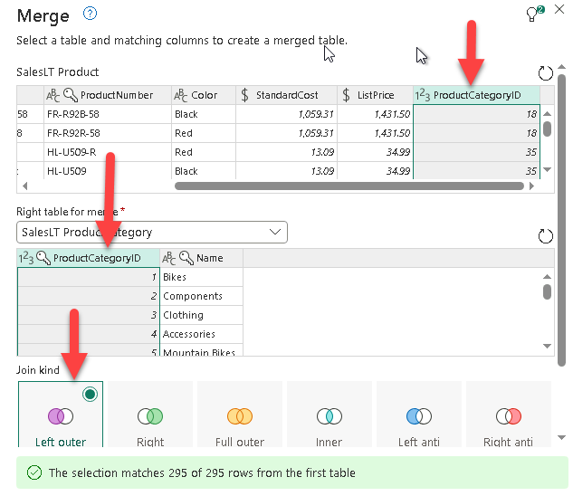
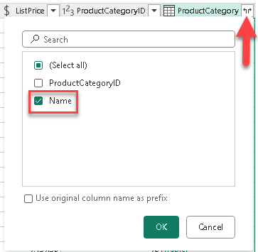
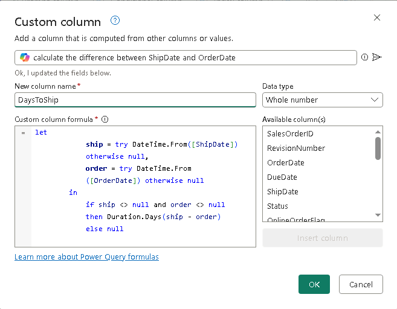
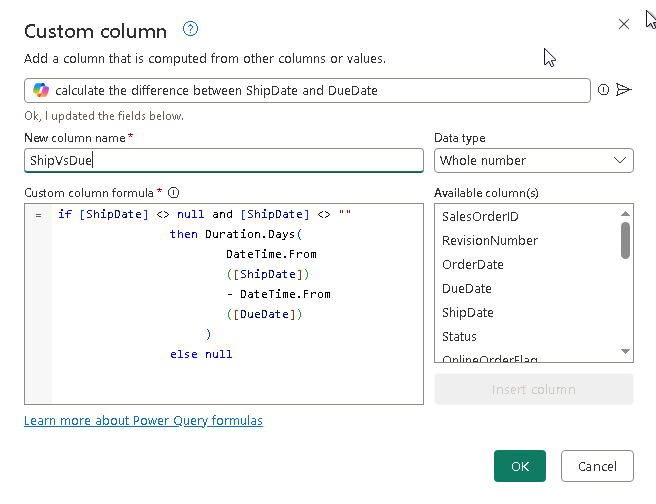
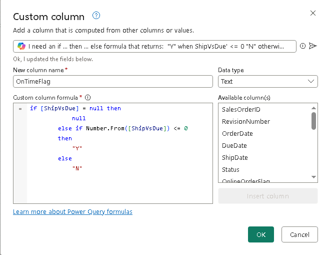
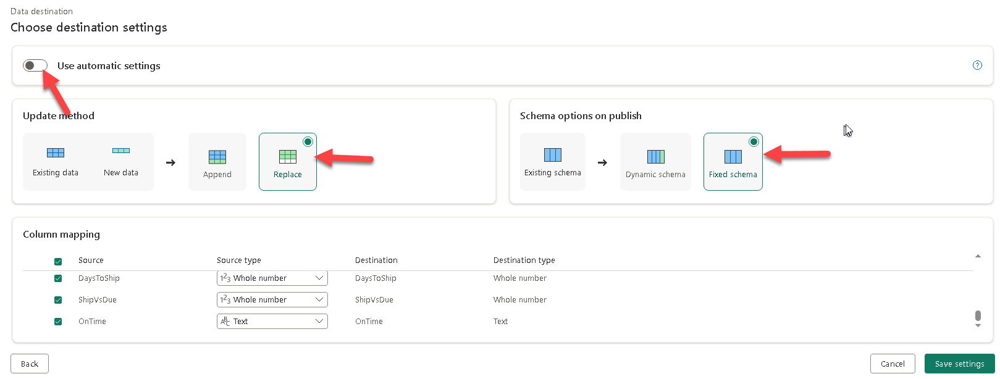

# Module — Dataflow Gen2 & Mapping Dataflows

| | |
|---|---|
| **Duration** | 60 minutes |
| **Objective** | Load dimension and fact tables into a Lakehouse using Dataflow Gen2 with Power Query, Mapping Dataflow transforms, and Incremental Refresh |
| **Skills** | Dataflow Gen2 (Power Query) · Mapping Dataflow (MDF Transforms) · Incremental Refresh · Parameters · Pipeline Orchestration |

---

## Overview

This lab introduces two core Fabric data integration features for loading structured data into a Lakehouse:

| Feature | Style | Use Case |
|---|---|---|
| **Dataflow Gen2 (Power Query)** | Code-free data prep | Load and shape dimension tables from SQL Server |
| **Mapping Dataflow (MDF Transforms)** | Visual, Spark-backed ETL | Load and enrich fact tables with computed columns |
| **Dataflow Gen2 Incremental Refresh** | Partition-aware fact loading | Load large fact tables with rolling refresh windows |

> **Note:** It is best practice to keep **dimension** and **fact** table loads in **separate Dataflows** for maintainability and incremental refresh flexibility.

---

## Prerequisites

### Create a Lakehouse (if needed)

If you do not already have a Lakehouse, create a new one:

1. In your workspace, select **+ New item** → **Lakehouse**.
2. Name it `LH_AdvWorks`. Leave the schema option selected.

---

## Exercise 1 — Dataflow Gen2 for Dimension Tables

**Goal:** Use Dataflow Gen2 with Power Query to load Customer, Product, and ProductCategory dimension tables from SQL Server into the `LH_AdvWorks` Lakehouse.

### Steps

#### Create the Dataflow

1. In your workspace, select **+ New item** → **Dataflow Gen2**.
2. Name it `DF_DIM_Tables`.

#### Configure Options

3. On the **Home** tab of the ribbon, open the **Options** dialog.
4. Under **General**, enable:
   - **Always allow parameterization in data source and transformation dialogs**
5. Under **Scale**, make the following selections:
   - Enable - Allow use of fast copy connectors
   - Enable - Allow use of the modern query evaluation engine
   - Enable - Optimized copy to Lakehouse
   - Disable - Enable V-order compression
   - accept the defaults on any other options
6. Close the dialog.

#### Create Parameters

> **Best practice:** Parameterize your server and database names rather than hardcoding them in queries.

7. On the **Home** tab, select **Manage Parameters** → **New Parameter**.
8. Create the first parameter:
   - **Name:** `ServerName`
   - **Type:** Any
   - **Current value:** `sqldiws2026.database.windows.net`
9. Select **New** and create a second parameter:
   - **Name:** `DBName`
   - **Type:** Any
   - **Current value:** `sqldb-di-workshop-diuserXX` (replace `diuserXX` with your workshop user number, e.g., `sqldb-di-workshop-diuser1`)
10. Close the dialog.

#### Get Data

11. From the **Get Data** dropdown, select **Azure SQL Database**.
12. Click the **pencil** dropdown for Server and Database and select the parameters `ServerName` and `DBName` created above.
13. Create a new connection (or select an existing one) by selecting the gateway in the dropdown (if needed), choose **Authentication kind: Organizational Account**, sign in, and select **Next**.
14. Select the **Customer**, **Product**, and **ProductCategory** tables. Select **Create**.
15. If not already visible, click **Diagram View** in the lower right to see a visual representation of your parameters used across the three queries.

#### Configure Queries

16. Right-click on each query and uncheck **Enable Staging** (the text will convert to italics).
17. Right-click to rename each query if needed: `Customer`, `Product`, `ProductCategory`.

18. With the **Customer** query selected, go to **Manage Columns** → **Choose Columns**.
    - Keep only: `CustomerID`, `FirstName`, `LastName`, `CompanyName`, `SalesPerson`, `EmailAddress`, `Phone`, `ModifiedDate`.
    - Select **OK**.
    - Click the **DateTime** icon in the `ModifiedDate` column and change the type to **Date**.

19. For the **Product** query, keep only: `ProductID`, `Name`, `ProductNumber`, `Color`, `StandardCost`, `ListPrice`, `ProductCategoryID`.

20. For the **ProductCategory** query, keep only: `ProductCategoryID`, `Name`.

21. Select the **Product** query, then choose **Combine** → **Merge queries** from the ribbon.
    - **Right table to merge:** `ProductCategory`
    - **Join columns:** `ProductCategoryID` (in both tables). Click on that column header in both tables.
    - **Join Kind:** Left outer
    - Select **OK**.

    

22. Expand the newly added `ProductCategory` column and select only the **Name** column.

    

23. Rename the expanded column to `ProductCategory`.

> **Tip:** Expand the Query settins panel on the right (if not already) and click through the different steps in each query to preview the data transformation at each point. Note that you can also edit the M code in the Formula Bar directly if desired.

#### Write Data to Lakehouse

24. From the ribbon, select the **Default data destination** dropdown → **Add**.
25. Scroll to the **OneLake Catalog** section and select the `LH_AdvWorks` Lakehouse. If you don't already have a default Lakehouse connector, create one with a unique name using Organizational account and sign in.
26. Click on the dbo Schema under the LH_AdvWorks (if schema was enabled on Lakehouse creation) and select 'Choose'
27. **Deselect** the `ProductCategory` query (its data was already merged into `Product`) and select **Bind selected queries**.

#### Refresh the Data

28. From the ribbon, select **Save & run** → **Save, run & close**.
29. Navigate back to your workspace and wait for the refresh to complete.
    - Hover over the spinning circle to check refresh status.
30. When the refresh completes, select the **ellipsis (…)** for the Dataflow → **Recent runs**.
31. Select the DateTime hyperlink to see refresh details for each query/activity, then click on an individual activity to view **Activity statistics**.

> **✅ Checkpoint:** The `Customer` and `Product` tables (with merged `ProductCategory`) should be visible in the `LH_AdvWorks` Lakehouse.

### Key Takeaways — Dataflow Gen2

- **Power Query familiar**: Same engine used in Power BI and Excel — easy onboarding for analysts.
- **Parameterized sources**: Server and database parameters make Dataflows portable and reusable.
- **Default destination**: Efficiently bind multiple queries to a Lakehouse in a single step.
- **Staging control**: Disabling staging for simple queries can improve performance.

---

## Exercise 2a (Optional) — Dataflow Gen2 with Mapping Dataflow for Fact Tables

**Goal:** Use the Mapping Dataflow feature within a new Dataflow Gen2 to load and enrich the `SalesOrderDetail` and `SalesOrderHeader` fact tables, then orchestrate the refresh with a pipeline.

> **Note:** You can duplicate the previous Dataflow using **Save As** to reuse the same parameters and connection, then modify it for fact tables, incremental refresh, etc. In this exercise we will create a new Dataflow using the Mapping Dataflow approach.

### Steps

#### Create the Dataflow

1. Create a new Dataflow Gen2 called `DF_Fact_Tables`.
2. In the ribbon, select **Run MDF Transforms**.

#### Configure the OrderDetail Source

3. Add a **Source** activity and configure it:
   - **Output stream name:** `SQLDB1`
   - **Connection type:** Azure SQL Server (or the source used above)
   - **Connection:** Select the same SQL Server connection used in Exercise 1 (or create a new one if needed)
4. In the upper right, use the slider to start a **Debug session** with a **1-hour Live duration**.
5. Under **Source Options**, select your database, schema, and the **SalesOrderDetail** table (hit **Refresh** as needed).
6. Under **Projection**, select **Import Schema** then **Overwrite Schema**. Change the `ModifiedDate` column to **Date** type.
7. Select **Data Preview** and **Refresh** to verify data is loading correctly.

#### Add a Select Activity

8. Add a **Select** activity and choose all columns **except** `rowguid`.

#### Rename and Duplicate for OrderHeader

9. In the **Queries** window, right-click the MDF action and rename it to `OrderDetail`.
10. Right-click `OrderDetail` and select **Copy**, then press **Ctrl + V** to paste a copy.
11. Rename the copy to `OrderHeader`.
12. Update the **Source Options** for `OrderHeader` to select the **SalesOrderHeader** table.
13. Under **Projection**, select **Import Schema** then **Overwrite Schema**. Change **all timestamp columns** to **Date** type.
14. Select **Data Preview** and **Refresh** to verify.
15. In the Select activity, select **Reset** to pick up the new column names, then choose all columns **except** `rowguid`.

#### Add Derived Column Activity

16. Select the **+** next to the Select activity and add a **Derived Column** activity.
17. Create the following computed columns:

    | Column Name | Expression |
    |---|---|
    | `DaysToShip` | `ShipDate - OrderDate` |
    | `ShipVsDue` | `ShipDate - DueDate` |

18. Select **Data Preview** and **Refresh**. Confirm that `DaysToShip` and `ShipVsDue` show integer values.

#### Configure the Destination and Save

19. In the bottom-left panel, add a **Default destination** pointing to the `LH_AdvWorks` Lakehouse.
20. Select **Save** to save the Dataflow.

#### Create an Orchestration Pipeline

21. In your workspace, create a new pipeline called `PL_MDF_OrderTables`.
22. Add a **Dataflow** activity:
    - **Name:** `Refresh OrderDetail`
    - **Dataflow:** Select `DF_Fact_Tables`
    - **Query:** Select the `OrderDetail` Dataflow query
23. Copy the activity and configure the copy:
    - **Name:** `Refresh OrderHeader`
    - **Query:** Select the `OrderHeader` Dataflow query
24. Run the pipeline and wait for the refresh to finish.

> **✅ Checkpoint:** All dimension and fact tables (`Customer`, `Product`, `OrderDetail`, `OrderHeader`) should be visible in the `LH_AdvWorks` Lakehouse.

### Key Takeaways — Mapping Dataflow in Dataflow Gen2

- **Visual + scalable**: Drag-and-drop canvas transforms backed by a Spark-compatible engine.
- **Derived columns**: Easily add business calculations like `DaysToShip` without writing raw SQL.
- **Debug sessions**: Live debug sessions let you preview data at each step before publishing.
- **Pipeline orchestration**: Wrap Dataflow refreshes in a pipeline to control order, parallelism, and dependencies.

---

## Exercise 2b — Dataflow Gen2 with Incremental Refresh for Fact Tables

**Goal:** Use a Dataflow Gen2 (Power Query) pattern with Incremental Refresh to load the `SalesOrderHeader` fact table into the same Lakehouse.

### Steps

#### Create a Fact Dataflow from the Dimension Dataflow

1. Back in your workspace, open the ellipsis (**...**) next to `DF_DIM_Tables` and select **Save As**.
2. Name the copy `DF_Fact_Tables_IR` (or a similar name).
3. Open the copied Dataflow.
4. Right-click each of the 3 queries (`Customer`, `Product`, and `ProductCategory`) and select **Delete**. Leave the `ServerName` and `DBName` parameters in place.
5. Create a new query for the `SalesOrderHeader` table by repeating steps 11–14 from Exercise 1: select **Get Data** → **Azure SQL Database**, set Server and Database to the `ServerName` and `DBName` parameters, select your existing connection, and select only the **SalesOrderHeader** table. Then, as in step 16, right-click the query and uncheck **Enable Staging**.

#### Shape the Query

6. Add a **Choose columns** step and select all columns except these:
   - `rowguid`
   - `SalesLT.Address(BillToAddressID)`
   - `SalesLT.Address(ShipToAddressID)`
   - `SalesLT.Customer`
   - `SalesLT.SalesOrderDetail`
7. On the **Add column** tab, select **Custom column**.
8. Create custom column `DaysToShip` using a formula that calculates the difference between `ShipDate` and `OrderDate`. Note you can double click on column names in the Available Columns box to add them to the formula. You can also use the **Copilot** prompt at the top of the **Custom column** dialog to write the formula for you (for example, `calculate the difference between ShipDate and OrderDate`), or copy and paste this formula:

    ```powerquery
    let
        ship = try DateTime.From([ShipDate]) otherwise null,
        order = try DateTime.From([OrderDate]) otherwise null
    in
        if ship <> null and order <> null
        then Duration.Days(ship - order)
        else null
    ```

    
9. Create custom column `ShipVsDue` using a formula that calculates the difference between `ShipDate` and `DueDate`. As with the previous step, you can use the **Copilot** prompt at the top of the **Custom column** dialog (for example, `calculate the difference between ShipDate and DueDate`), or copy and paste this formula:

    ```powerquery
    if [ShipDate] <> null and [ShipDate] <> ""
    then Duration.Days(
            DateTime.From([ShipDate])
            - DateTime.From([DueDate])
         )
    else null
    ```

    
10. Convert both columns to **Whole Number** type through either the right-click options or by clicking on left side of column header (ABC123).
11. Add another custom column named `OnTime` with an `if ... then ... else` formula that returns:
    - "Y" when `ShipVsDue <= 0`
    - "N" otherwise
    - null when `ShipVsDue` is null
    - Change the data type to Text

    As with the previous steps, you can use the **Copilot** prompt at the top of the **Custom column** dialog. Your prompt **must include how to handle nulls**, or Copilot will get the formula wrong. For example:

    ```text
    I need an if ... then ... else formula that returns: "Y" when ShipVsDue' <= 0 "N" otherwise. If the value is null then we should evaluate it as null
    ```

    Or copy and paste this formula:

    ```powerquery
    if [ShipVsDue] = null then
        null
    else if Number.From([ShipVsDue]) <= 0 then
        "Y"
    else
        "N"
    ```

    

#### Configure Destination Settings for Incremental Refresh

12. Remove the existing data destination that was copied over from `DF_DIM_Tables`.
13. Add a new destination that points to the same `LH_AdvWorks` Lakehouse. Be sure to use the **Add data destination** button on the ribbon, not the **Default data destination** button.
14. Turn off **Use automatic settings** (required for incremental refresh)
15. Set: (required for incremental refresh)
    - **Update method:** Replace
    - **Schema option:** Fixed Schema

    
16. Select **Save settings**.

> **Note:** These destination settings are required to enable Incremental Refresh in this pattern.

#### Enable Incremental Refresh

17. Right-click `SalesOrderHeader` in the list of Queries on the left and select **Incremental Refresh**.
18. Check the box to enable and configure the dialog with:
    - **Column to filter by:** `OrderDate`
    - **Extract data from past:** 36 months
    - **Bucket size:** Month
    - **Detect data changes using:** `ModifiedDate`
    - Uncheck **Require that query fully folds** enabled in the Advanced options section (the custom columns we've created may not fold back to the source)
19. Confirm the query icon shows the Incremental Refresh symbol in the list of Queries on the left.

#### Refresh the Data

20. From the ribbon, select **Save & run** → **Save, run & close**.
21. Navigate back to your workspace and wait for the refresh to complete.
    - Hover over the spinning circle to check refresh status.
22. When the refresh completes, select the **ellipsis (…)** for the Dataflow → **Recent runs**.
23. Select the DateTime hyperlink to see refresh details for each query/activity, then click on an individual activity to view **Activity statistics**.

> **✅ Checkpoint:** `SalesOrderHeader` is configured with Incremental Refresh and loads to `LH_AdvWorks`.

### Key Takeaways — Incremental Refresh in Dataflow Gen2

- **Scales fact loads**: Process only recent partitions instead of reprocessing full history each refresh.
- **Change detection aware**: Use a modified date column to detect which partitions need updates.
- **Model-friendly outputs**: Keep derived columns such as `DaysToShip`, `ShipVsDue`, and `OnTime` in the data preparation layer.
- **Configuration-sensitive**: Destination and schema settings must be aligned before Incremental Refresh can be enabled.

---

## Bonus — Direct Lake Semantic Model and Report

Create a simple **Direct Lake semantic model** from the `LH_AdvWorks` Lakehouse to analyze the loaded dimension and fact data:

1. In your workspace, open `LH_AdvWorks`.
2. Select **New semantic model** and choose the tables you want to include.
3. Define relationships between the fact and dimension tables (e.g., `OrderDetail[ProductID]` → `Product[ProductID]`).
4. Open **Power BI** and create a report connected to the Direct Lake model to explore the data.
